# Havoc Web 控制台

Havoc Framework 的 Web 控制台：在浏览器里完成监听器、载荷生成、会话管理、命令执行、文件与
进程操作、战利品查看和团队协作。网关把浏览器请求转成 Teamserver 的 JSON over WebSocket 协议，
因此无需安装 Qt 客户端，也不必修改 Teamserver / Demon。

> **2026-11-11 变更：Qt 客户端已从本仓库移除**，只保留 Teamserver + Web 控制台。
> `havoc-src/client/Modules`（Python 模块 + BOF 对象文件）作为 Web 端的模块命令库保留，
> 模块命令（help 表 73 行，`REGISTERED_COMMANDS` 注册 77 条；`netview`、`kerberoast`、`nanodump` 等）依赖它，**不要删除**。
> 命令表来源固化在 `webui/reference/`，移除前的 Qt 客户端完整备份见 `backup/qt-client-20261111.tar.gz`。

上游项目：[HavocFramework/Havoc](https://github.com/HavocFramework/Havoc)（部署版本 **0.7 / Bites The Dust**）。

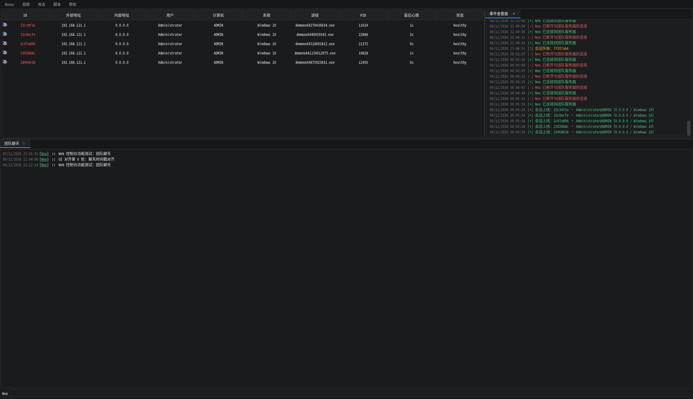

| 模块 | Web 控制台能力 |
| --- | --- |
| 会话 | 会话表（含投递标记、颜色标记）、双击开控制台、右键菜单、拓扑图、标记 Alive/Dead |
| 文件 | 工具栏（刷新 / 新建目录 / 新建文件 / 上传）+ 拖拽上传，右键打开、下载、重命名、复制、移动、删除、属性，文本在线编辑 |
| 进程 | PPID 进程树 + 进程表、刷新、右键结束进程 |
| 监听器 | 原生 HTTP/HTTPS/SMB/External、8 种加密传输（TCP/KCP/UDP/WS/DNS/DoH/DoT/OSS）、服务端插件监听器；下载中继、一键上线 |
| 载荷 | 生成弹窗（Agent / 监听器 / 架构 / 5 种格式 + 休眠与注入配置）、实时构建控制台、产物下载 |
| 其它 | 团队聊天、事件查看器、战利品预览、扩展商店、脚本管理与脚本控制台、团队服务器日志 |
| MCP | MCP 管理页：运行态启停、令牌复制/轮换、端口修改；69 工具 / 15 资源 / 3 提示词 |
| 集成 | REST + WebSocket 接口；MCP 支持 HTTP 与 stdio；网关断线自动重连 |
| 浏览器 | 多标签工作区、标签栏横向滚动、会话颜色与命令历史存于 localStorage、HMAC 登录 cookie（默认 12h） |

---

## 1. 功能截图

> **说明：本章截图全部来自本仓库的 Web 控制台（浏览器界面），不是 Qt 客户端截图。**
> Qt 客户端截图位于 `logs/client-shots/`，该目录不纳入版本库。

### 1.1 会话总览

顶部为 6 个菜单：`Havoc`（新建窗口 / 断开 / 退出 / 重新连接 teamserver）、`视图`、`攻击`、`MCP`、`脚本`、`帮助`。
主区是会话表（ID / 外部地址 / 内部地址 / 用户 / 计算机 / 系统 / 进程 / PID / 最后心跳 / 状态），
由上级投递来的会话在 ID 旁显示 `↳` 标记，右键可为会话设置颜色标记；
右侧为事件查看器 dock（可拖拽宽度，`视图 → 事件查看器` 开关），
下方标签区承载团队聊天、监听器、战利品、扩展、脚本、MCP 管理与各会话的控制台 / 文件 / 进程页。


### 1.2 会话控制台

双击会话行（或拓扑图节点）打开控制台标签页。输入 `help` 显示 Demon 命令表，Linux 会话会为
Windows 专有命令标注「仅 Windows」；支持 Tab 补全，命令历史按会话独立保存（每个会话最多 200 条）。
控制台右侧的「上传」可把本地文件送到网关并自动插入服务器路径，底部状态行显示
`[用户/计算机] 进程/PID 架构`。

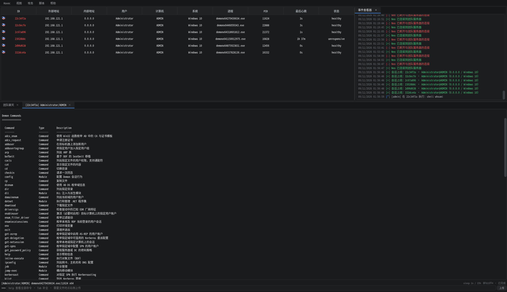

### 1.3 文件管理器

每个会话独立文件标签：左侧目录树、右侧列表（名称 / 大小 / 修改时间 / 操作），
工具栏为「刷新 / 新建目录 / 新建文件 / 上传」，也可把文件直接拖入列表上传（支持多选）；
右键菜单含打开（目录）、编辑（文本文件）、下载、重命名、复制到…、移动到…、删除、复制路径、属性。
删除目录可递归，Windows 与 Linux 会话共用同一套界面。

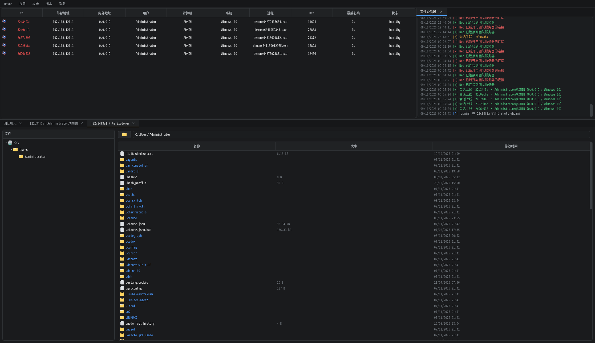

### 1.4 进程列表

左侧为 PPID 进程树，右侧为进程表（名称 / PID / PPID / 会话 / 架构 / 用户），当前进程红色标注；
工具栏可刷新，右键选择「结束进程」下发 `proc kill`。

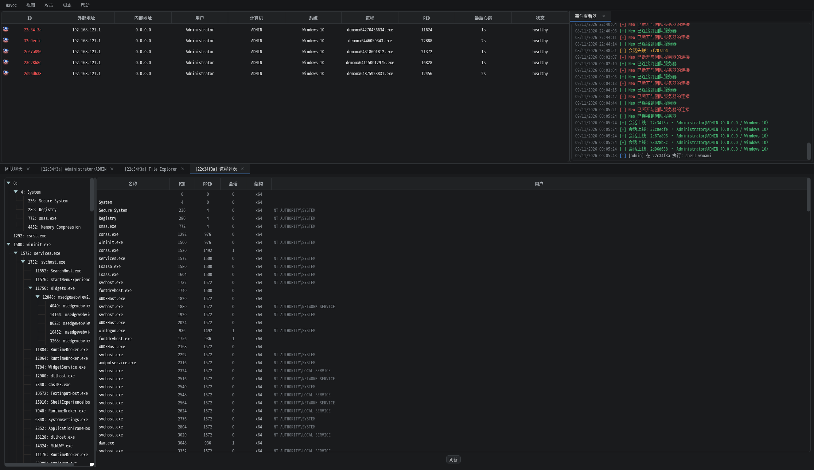

### 1.5 会话拓扑图

`视图 → 会话视图 → 拓扑图` 把主区切换为拓扑：防火墙图标为 Teamserver 根节点，会话按投递 / 枢轴
关系从左到右展开，直属会话绿线、枢轴蓝线、断开的枢轴红线；`视图 → 投递链虚线` 可叠加显示投递
父会话的虚线。滚轮以光标为锚缩放（0.3–3），拖动背景平移，工具栏提供 `− / + / 适应`；
点击节点打开控制台，右键弹出会话菜单。

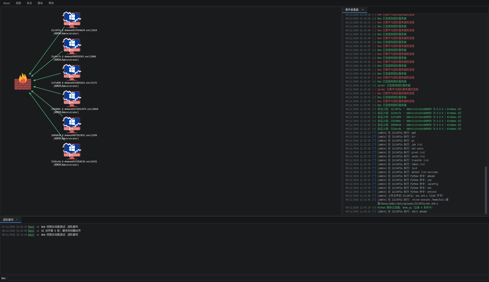

### 1.6 载荷生成

`攻击 → 载荷生成` 打开生成弹窗：选择 Agent、监听器（仅列在线项）、架构（x64 / x86）与格式
（Windows Exe / Windows Dll / Windows Shellcode / Windows Service Exe / Linux Exe）；
配置树包含休眠时间、抖动比例、服务名称、间接系统调用、栈复制、休眠技术（WaitForSingleObjectEx /
Foliage / Ekko / Zilean）、休眠跳转指令、代理加载、Amsi/Etw 补丁，以及可折叠的进程注入
（64 / 32 位注入进程）。选择 Linux Exe 时 Windows 专属配置自动隐藏。
下方「构建控制台」实时显示 Teamserver 的交叉编译日志，生成完成后可直接下载；
产物保存在 `webui/data/payloads/<id>/`，网关重启后仍可下载。

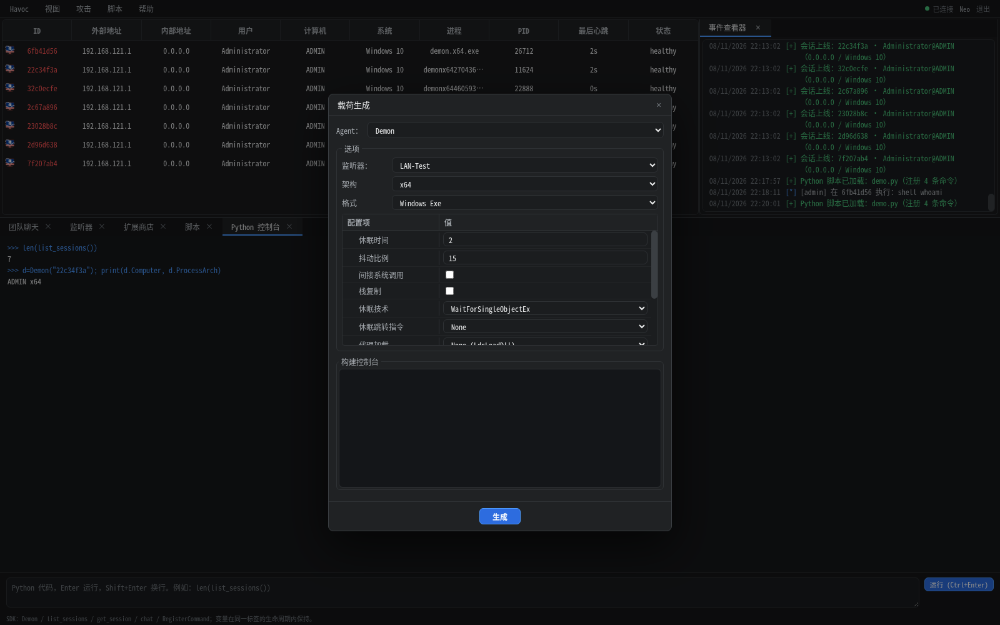

### 1.7 监听器

监听器页表格列为名称 / 模式 / 监听 / 外连 / 状态 / 加密 / 连接。「添加」支持：

- **原生**：HTTP、HTTPS、SMB（只填管道名）、External（单个路径段，注册到 40056）；
- **加密传输（Web 网关）**：TCP / KCP / UDP / WS / DNS / DoH / DoT / OSS，HTP/1 握手 + AES-256-GCM；
- **服务端插件监听器**：由 Teamserver 插件注册的协议，按插件声明的 Items 动态生成字段。

行内可启动 / 停止、编辑（SMB 与 External 需删除重建）、「下载中继」生成 Windows/Linux 中继器，
以及「一键上线命令」（`/swt` 批处理与 `/slt` 脚本）。

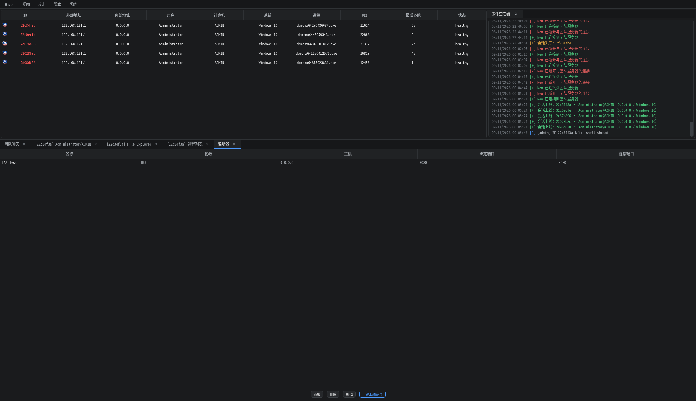

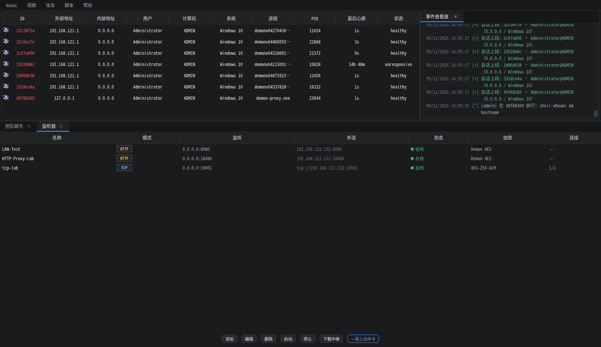

### 1.8 战利品

顶部可按 Agent（`[ All ]` 或指定会话）与「显示」（截图 / 下载）过滤：截图列表单击在右侧预览，
双击或右键下载原始 PNG；下载文件列表单击即下载。左右分隔条可拖动放大预览，
战利品落盘保存，网关重启后恢复。

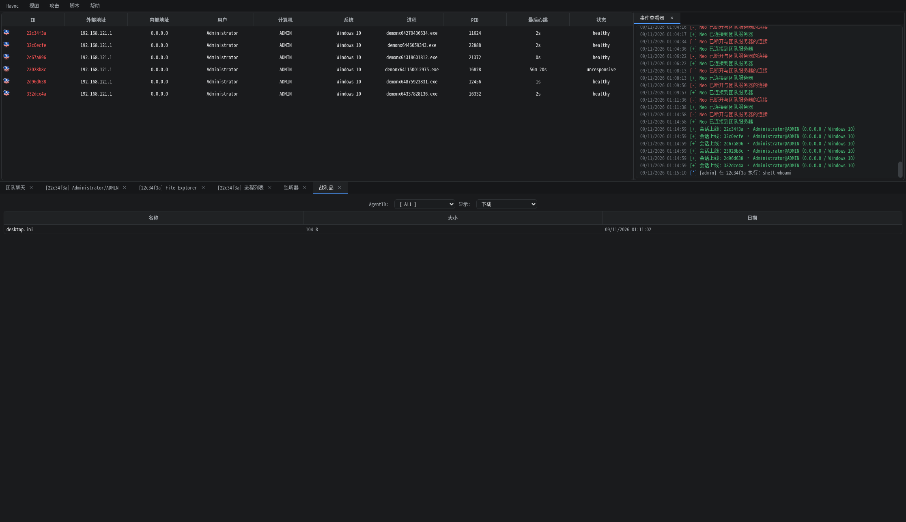

### 1.9 扩展商店与脚本

扩展商店为名称 / 作者两列 + 右侧详情（标题、作者、描述、链接），底部为安装区与日志；
数据来自 `p4p1/havoc-store`（GitHub 直连失败时走镜像，再回退本地 `client/Modules`），
支持 gist 与仓库安装，安装时限制 tar.gz 解压路径与体积。

脚本管理页左侧列出脚本路径，右侧显示源码、已注册命令与日志；可上传 `.py`、加载、重新加载、卸载。
脚本控制台是持久 REPL（Enter 运行、Shift+Enter 换行），SDK 提供 `Demon`、`RegisterCommand`、
BOF 回调等接口，注册的命令可直接在会话控制台调用。
（截图中的「Python 控制台」标签页即当前的「脚本控制台」。）

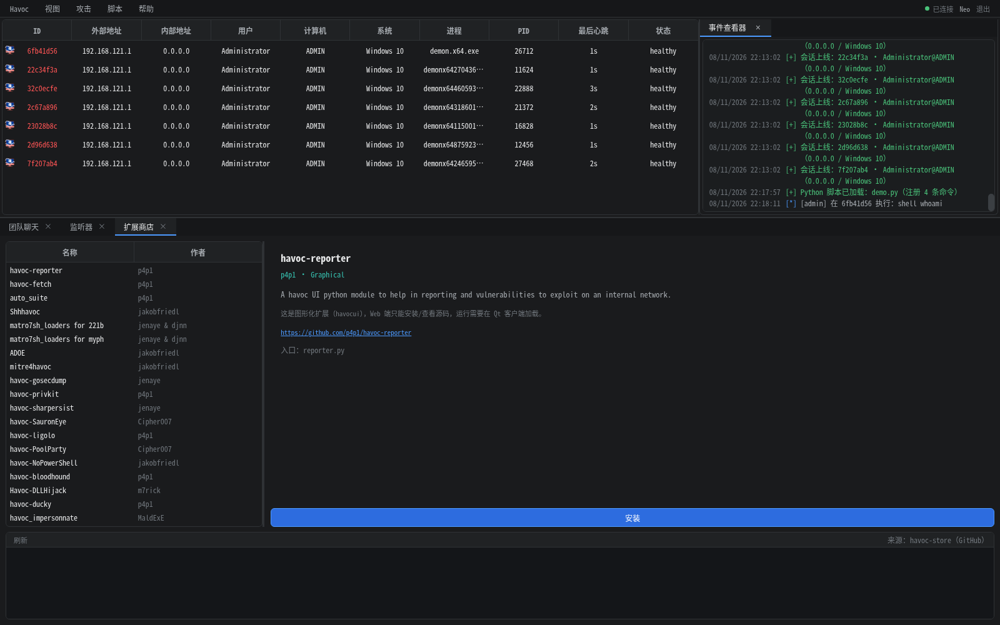

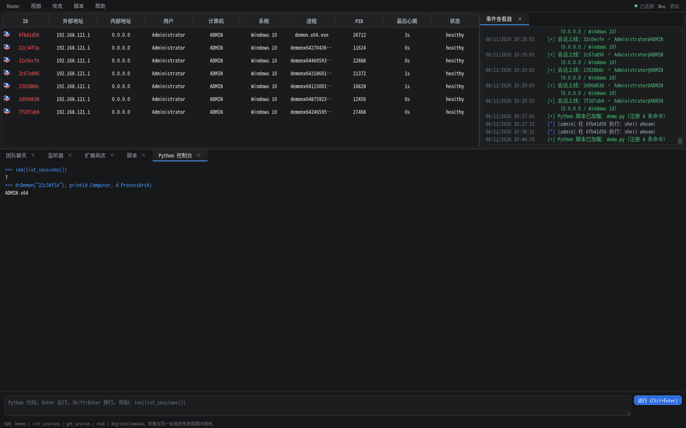

### 1.10 登录、聊天与右键菜单

登录页提交账号密码后换取 HMAC 签名 cookie（默认 12 小时，网关重启后免登录，断线自动重连）。
团队聊天与 Teamserver 广播互通；会话右键菜单包含 交互、资源管理器（进程列表 / 文件浏览器）、
标记为存活 / 已死亡、颜色标记（7 色 + 重置）、投递链（设置投递父会话… / 清除）、导出会话、
复制会话 ID、退出会话（线程 / 进程）与移除会话。

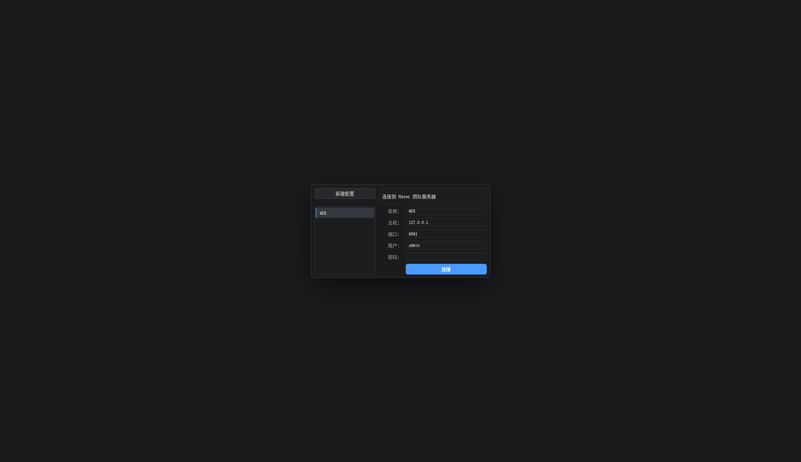

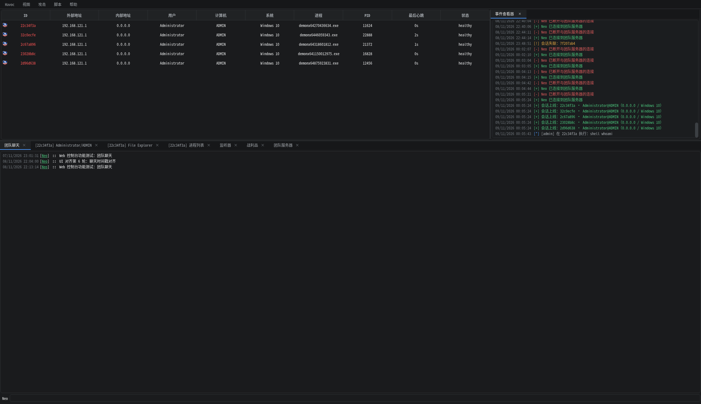

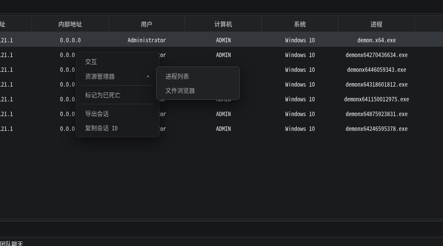

> 全部截图位于 `webui/docs/`，内容均为 Web 控制台界面。`ui-compare-*.png` 是移除 Qt 客户端前
> 留下的历史对照图（上方 `WEB`、下方 `CLIENT`，下为已移除的 Qt 客户端）；
> `ui-parity-sheet.png` 为 13 屏功能总览拼图（同为 Web 控制台）。

---

## 2. 快速开始

### 2.1 前置条件

本仓库跟踪 Web 控制台、实验脚本、启停脚本与 `havoc-src/` 源码；以下内容体积大或为运行数据，**未纳入版本库**，需自行准备：

| 组件 | 位置 | 说明 |
| --- | --- | --- |
| Havoc 源码与二进制 | `havoc-src/` | 源码已并入本仓库（原嵌套 git 仓库已移除）；需自行编译出 `havoc-src/havoc`（Teamserver）；Qt 客户端已移除，`client/Modules`（Python 模块 + BOF 对象）已入库供 Web 端复用 |
| 本地工具链 | `toolchain/` | Go、CMake、Python venv，仅在重新编译时需要（Qt5 已随客户端移除） |
| 运行数据 | `webui/data/`、`webui/run/` | 战利品、载荷、MCP 令牌与密钥，首次启动自动生成 |
| 载荷产物 | `payloads-out/` | 一键上线投递目录 |

系统要求：Linux（Kali 验证）、Python 3.11+、`aiohttp`（见 `webui/requirements.txt`）。

### 2.2 一键启动

```bash
cd /home/kali/桌面/Havoc
./start-all.sh              # 后台启动 Teamserver + Web 控制台 + 暂存服务
./start-all.sh --status     # 查看三个服务的运行状态（全部运行返回 0）
./stop-all.sh               # 全部停止
```

- 脚本幂等：已在运行的服务直接复用，不会重复拉起或抢占端口；
- 就绪检查：等待 Teamserver 端口 `40056` 监听、Web `/api/health` 通过后才报告成功；
- 按需跳过：`--no-webui`、`--no-stager`、`--no-teamserver`；
- 日志：`logs/teamserver.log`、`logs/webui.log`、`logs/webui-console.log`、`logs/stager.log`。

### 2.3 分别启动（调试）

```bash
./start-teamserver.sh       # 前台运行 Teamserver，Ctrl+C 停止
cd webui && ./start-webui.sh  # 后台启动 Web 控制台（含健康检查）
```

| 服务 | 地址 | 凭据 |
| --- | --- | --- |
| Web 控制台 | <http://127.0.0.1:8081/> | `admin` / `havoc1234`（`webui/config.json`） |
| Teamserver | `wss://127.0.0.1:40056` | 供网关连接：`Neo` / `password1234`（Qt 客户端已移除，`5pider` 账号已删除） |
| 一键上线服务 | <http://127.0.0.1:9901/> | 无 |

> 用户名区分大小写；网关以 `Neo` 连接 Teamserver。Qt 客户端移除后不再有第二个操作员连接，
> 多浏览器共用该连接（详见 `webui/README.md` 已知限制）。
> **默认口令仅用于本地演示，正式使用前请修改** `havoc-src/profiles/havoc.yaotl` 与 `webui/config.json`。

### 2.4 基本使用流程

1. **登录**：浏览器打开 `http://<网关IP>:8081/`，用 `admin` / `havoc1234` 登录，进入会话表与事件查看器。
2. **新建监听器**：`视图 → 监听器 → 添加`，选择模式并保存；加密传输监听器还需「下载中继」，
   在目标侧运行中继器并把原生 HTTP 监听器的「载荷代理」指向 `127.0.0.1:1080`。
3. **生成载荷**：`攻击 → 载荷生成`，选在线监听器、架构与格式，点击「生成」，等构建控制台输出完成后下载。
4. **会话操作**：会话上线后双击打开控制台执行命令；右键菜单可打开文件浏览器 / 进程列表、
   设置颜色标记、设置投递父会话、导出会话，或标记 Alive/Dead。
5. **查看拓扑**：`视图 → 会话视图 → 拓扑图` 查看投递与枢轴层级，可缩放、平移、点节点进控制台。
6. **对外集成**：`MCP → MCP 管理` 查看运行态、复制或轮换令牌、修改端口；工具清单与调用示例见第 3 节。
7. **一键上线**：`攻击 → 一键上线` 使用 9901 的 `/slt`（Linux）与 `/swt`（Windows）投递脚本。

---

## 3. MCP 外部调用

网关内置 MCP 服务，把 Web 的全部能力暴露给外部程序（共 69 个工具）：

```bash
# HTTP（Streamable HTTP）
curl -s http://127.0.0.1:8081/mcp \
  -H "Authorization: Bearer $(cat webui/run/mcp.token)" \
  -H 'Content-Type: application/json' \
  -d '{"jsonrpc":"2.0","id":1,"method":"tools/call","params":{"name":"havoc_list_sessions","arguments":{}}}'

# stdio（由本机 MCP 客户端拉起）
python3 webui/mcp_server.py --stdio

# 查看工具清单
python3 webui/mcp_server.py --list-tools
```

- 令牌：首次启动生成 `webui/run/mcp.token`（0600），也可在 `webui/config.json → mcp.token` 固定；
- 管理页：菜单 `MCP → MCP 管理`，可查看运行态、启停 `/mcp`、复制或轮换令牌、修改监听端口（无需重启网关）；
- 独立端口只提供 `/mcp`；停止后所有 `/mcp` 请求返回 503，浏览器 REST/WS 与投递链不受影响；
- 令牌等同操作员权限，请勿外泄。完整工具表见 [webui/README.md](webui/README.md) 第 10 节。

---

## 4. 目录结构

```
Havoc/
├── webui/                     # Web 控制台（本仓库主体）
│   ├── gateway.py             # aiohttp 网关：登录 / REST / WS / 静态页 / MCP 挂载
│   ├── havoc_client.py        # Teamserver WSS 客户端（自动重连）
│   ├── state.py               # 协议解码与状态缓存
│   ├── commands.py            # 命令构造与命令矩阵
│   ├── demon_commands.py      # Demon 命令定义与帮助
│   ├── transports.py          # 八种加密传输监听器
│   ├── linux_compat.py        # Linux 会话命令改写与 help 标注
│   ├── mcp_server.py          # MCP stdio 入口
│   ├── mcp_tools.py           # 69 工具 / 15 资源 / 3 提示词注册表
│   ├── filemanager.py         # 文件管理器后端
│   ├── static/                # 前端（深色主题，单页多标签）
│   ├── docs/                  # 设计文档、协议说明与界面截图
│   └── *_test.py              # 验收与回归脚本
├── stager/stager_server.py    # 9901 一键上线暂存服务
├── lab/                       # 受控实验环境（execd、交付链验证产物）
├── start-all.sh               # 一键启动（幂等 + 就绪检查）
├── stop-all.sh                # 一键停止
├── start-teamserver.sh        # 单独启动 Teamserver
├── start-stager.sh            # 单独启动暂存服务
├── backup/                    # 移除 Qt 客户端前的完整备份（不含 client/Modules）
├── README-DEPLOY.md           # 完整部署记录（编译、兼容性、验证结果）
└── HANDOFF-*.md               # 开发交接说明
```

版本库不包含：`havoc-src/`、`toolchain/`、`logs/`、`payloads-out/`、`webui/data/`、`webui/run/`、
编译产物与缓存，规则见 [.gitignore](.gitignore)。

---

## 5. 测试与验收

```bash
cd webui

python3 acceptance.py          # 端到端验收：登录 / 会话 / shell / 审计 / 重连 / 9901
python3 command_test.py        # 命令矩阵与协议构造
python3 ui_feature_test.py     # CDP 无头浏览器 UI 回归
python3 mcp_test.py            # MCP 协议与工具（--live 追加在线只读检查）
python3 mcp_admin_test.py      # MCP 管理页
python3 service_listener_test.py
python3 linux_agent_test.py
python3 transport_test.py
```

| 项目 | 结果 |
| --- | --- |
| `acceptance.py` | 15 / 15 |
| `ui_feature_test.py` | 15 / 15 |
| `command_test.py` | 34 / 34 |
| `mcp_test.py` | 离线 40 项；`--live` 47 项 |
| `mcp_admin_test.py` | 92 项 |
| `service_listener_test.py` | 25 / 25 |
| `linux_agent_test.py` | 20 / 20 |

> 标注「验收」的脚本需要 Teamserver 与 Web 控制台在运行，部分用例依赖 `/etc/hosts` 或本机网络环境。

---

## 6. 已知限制

- **Linux Demon**：不支持 SMB pivot、令牌窃取、注入、BOF、.NET、WMI、Kerberos 等 Windows 专有语义，
  `help` 中对应命令标注「仅 Windows」；二进制约 6 MB，未做 UPX 与休眠混淆。
- **服务端插件监听器**：不写入 Teamserver 数据库，删除不通知插件；创建时若插件未注册会返回 502。
- **扩展商店**：图形化（havocui）扩展可安装查看，但依赖 Qt 客户端进程内的 Python UI 绑定；
  Qt 客户端移除后**无法运行**，只能改写为 CLI 脚本或用 pysdk 重新实现。
- **拓扑图**：会话列表来自 Teamserver 快照；若另一个长期在线的客户端错过了 `NewSession`，
  两边显示可能不一致，重连该客户端即可对齐。
- **安全**：网关默认监听 `0.0.0.0:8081` 仅为方便同网段访问，**不要暴露到办公网或公网**；
  需要加密时配置 `web.tls_cert` / `web.tls_key`。

---

## 7. 更多文档

| 文档 | 内容 |
| --- | --- |
| [README-DEPLOY.md](README-DEPLOY.md) | 编译、工具链兼容、中文二开、一键上线、Linux Demon 全量验证 |
| [webui/README.md](webui/README.md) | 架构、配置、REST/WS 接口、Python SDK、MCP 工具表、限制 |
| [webui/docs/TRANSPORTS.md](webui/docs/TRANSPORTS.md) | 加密传输协议、字段与模式边界 |
| [webui/docs/command-matrix.md](webui/docs/command-matrix.md) | 命令矩阵与平台差异 |
| [HANDOFF-WEBUI.md](HANDOFF-WEBUI.md) | Web 控制台开发交接 |
| [lab/README.md](lab/README.md) | 实验环境搭建与交付链验证 |

---

> 本项目仅供**已获得明确书面授权的安全测试**与自有环境研究使用。请遵守当地法律法规，
> 不得用于未授权的目标。
